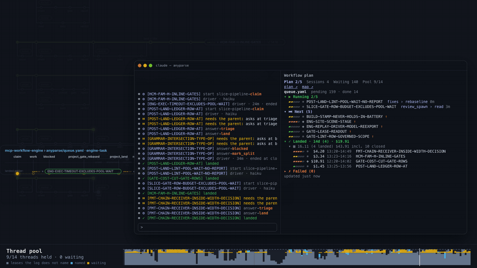

<p align="center">
  <a href="https://axgord.github.io/claude-workflow/"></a>
</p>

<p align="center">
  <a href="https://www.npmjs.com/package/claude-mcp-workflow"></a>
  <a href="LICENSE"></a>
  <a href="https://www.typescriptlang.org/"></a>
  <a href="https://code.claude.com/docs/en/plugins"></a>
</p>

<p align="center">
  
</p>

A Claude Code plugin that drives agents through YAML-defined state machines. The engine tracks the state,
enforces the guards and hands the agent one prompt at a time; a web dashboard shows everything that runs.

## Why

- **Agents lose their step.** A long task drifts, a context is compacted, Claude Code restarts. The engine
  keeps the state, so the agent always gets the next prompt, not a guess.
- **Parallel builds choke the machine.** Four agents start a build each and the laptop stops answering.
  A machine-wide thread pool makes them queue.
- **No picture of what runs.** Sessions, branches and reviews are in flight and the only view is scrollback.
  A live map and a plan pane show them.

## Features

- **State machines in YAML** — states, transitions, prompts, nested sub-workflows ([Workflow YAML][yaml])
- **Action states** — `exec` runs a command, `fetch` an HTTP request, routed by exit code ([Action states][action])
- **Thread pool** — heavy builds and tests, agents' own included, share one machine-wide budget ([Thread pool][pool])
- **Task queue** — a picker, a cheap driver per task, model by difficulty, lessons filed by script ([Queue][queue])
- **Subagents** — driver, experimental dispatcher (off unless `WF_DISPATCHER`), recon, reviewer ([Agent types][agents])
- **21 bundled workflows**, **29 bundled skills** (14 by default, 15 on request) ([Concepts][concepts])
- **Survives a restart** — sessions are suspended, not lost; `claude --resume` continues them ([Restart][restart])
- **Live dashboard** — map, plan pane (in your terminal's theme), status line, light or dark ([Dashboard][dashboard])

## Install

**Prerequisites:** Claude Code, Node.js 22 or newer, and [`jq`](https://jqlang.github.io/jq/) on your `PATH`
(`brew install jq`, `apt install jq`). The session hooks read their input with `jq`; without it the start hook
prints a one-line notice and skips the plan resume, the resume pickup and the conversation stamp.

```bash
/plugin marketplace add AxGord/claude-workflow
/plugin install workflow@claude-workflow
```

This repository as a marketplace gives the latest release, built: the plugin comes from the repository's
`release` branch, which holds `master` plus the compiled `build/`. A development checkout is not that tree: build it
yourself (details below). The `claude-community` catalog (`anthropics/claude-plugins-community`) may serve an older
version (its entry is pinned to 0.1.11, which has no `build/`, so the server does not start): do not install from
it until its pin is bumped.

To remove it, run `wf-skills remove` first (it deletes the unedited skill copies the plugin put in `~/.claude/skills`
and the staging directories of an interrupted update;
your edited copies and `learned-*` skills stay), then `/plugin uninstall workflow`.
[Concepts](https://axgord.github.io/claude-workflow/concepts#updating-and-removing-the-skills) lists what stays.

**Two ways to use it.** *One task:* with the CLAUDE.md snippet every conversation starts the `master` workflow,
which picks a bundled one (`bug-fix`, `coding`, `new-feature`, ...) and hands the agent one prompt at a time; a
named one starts with `start({ workflow: "bug-fix" })` or by asking. *A queue:* for many tasks, a queue file
plus the `batch` workflow runs one task workflow per line, several at once, each under a driver agent. A
workflow of your own comes from asking the agent (it loads the bundled `wf-yaml-authoring` skill) or from
writing the YAML by hand. Step by step:
[Getting started](https://axgord.github.io/claude-workflow/getting-started), which also covers the other
install channels (this repository, npm, a local checkout, manual) and the CLAUDE.md snippet.

## Quick start

Save this as `.claude/workflows/ship.yaml` in your project:

```yaml
name: ship
description: "Plan, do, test, finish"
initial: plan

states:
  plan:
    prompt: "List the steps for the task in two lines."
    transitions:
      go: do

  do:
    prompt: "Do the steps, then report what changed."
    transitions:
      done: test

  test:
    type: exec
    command: "npm test"
    on_success: finish
    on_error: do

  finish:
    terminal: true
    outcome: complete
```

Ask the agent to run it. It calls `start` with `workflow: "ship"` and gets the prompt of `plan`; each `transition`
call returns the next prompt. The `test` state runs by itself and routes on the exit code: a failure goes back to `do`.
Open `http://localhost:3100` to watch the session and its graph.

## Documentation

The full documentation is the site **https://axgord.github.io/claude-workflow/** (sources in `docs/`).

| Page | Covers |
|------|--------|
| [Getting started](https://axgord.github.io/claude-workflow/getting-started) | Install channels, the `wf-*` commands (`wf-validate` checks that a project's workflow files load), the CLAUDE.md snippet, one task or a queue, your own workflow, permissions, trusting a project's exec states (Claude Code's folder trust, `wf-trust` as the fallback; what consent does and does not protect against, and the guarded writes of the trust record and the global workflows directory) |
| [Concepts](https://axgord.github.io/claude-workflow/concepts) | How it works, bundled workflows and skills, MCP tools |
| [Use case: anyparse](https://axgord.github.io/claude-workflow/use-case-anyparse) | A real project on the engine: a queue line's way by its difficulty, with the project's own numbers |
| [Workflow YAML](https://axgord.github.io/claude-workflow/workflow-yaml) | The file format, three-tier loading, `extends:` |
| [Action states](https://axgord.github.io/claude-workflow/action-states) | `exec`, `fetch`, routing, fan-out, guards, restart |
| [Thread pool](https://axgord.github.io/claude-workflow/pool) | Why parallel agents queue: leases, budget, priority, `wf-run` |
| [Task queue and dispatch](https://axgord.github.io/claude-workflow/queue) | `queue_next`, `wf-queue`, the model table, drivers, agent types |
| [Dashboard and plan pane](https://axgord.github.io/claude-workflow/dashboard) | The plan pane, the live map, the status line |
| [FAQ](https://axgord.github.io/claude-workflow/faq) | Troubleshooting |
| [Development](https://axgord.github.io/claude-workflow/development) | Commands, source layout, the site, the replay, the banner |

## Contributing

Build, test and source layout: [Development](docs/development.md). Run `npm run check` before a commit.

## License

MIT

[yaml]: https://axgord.github.io/claude-workflow/workflow-yaml
[action]: https://axgord.github.io/claude-workflow/action-states
[pool]: https://axgord.github.io/claude-workflow/pool
[queue]: https://axgord.github.io/claude-workflow/queue
[agents]: https://axgord.github.io/claude-workflow/queue#agent-types
[concepts]: https://axgord.github.io/claude-workflow/concepts
[restart]: https://axgord.github.io/claude-workflow/action-states#restart-suspend-and-resume
[dashboard]: https://axgord.github.io/claude-workflow/dashboard
