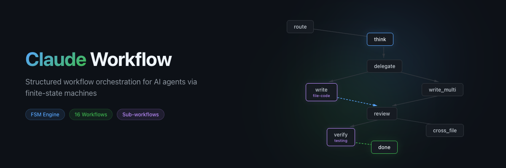
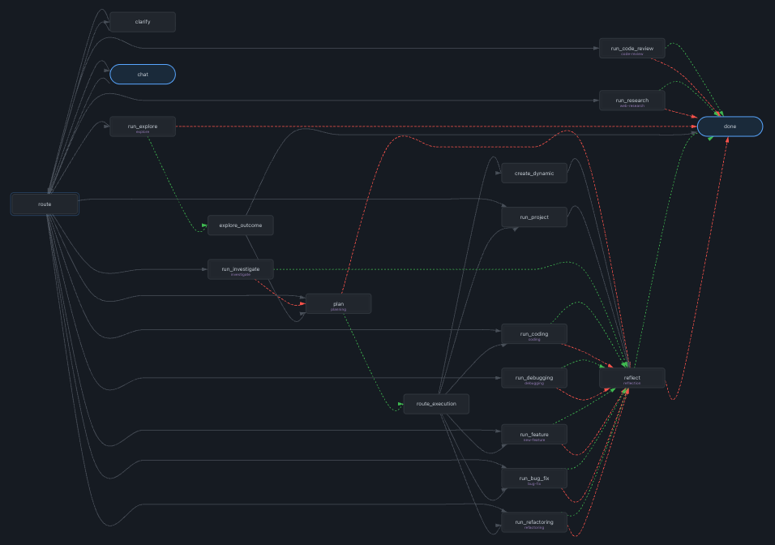
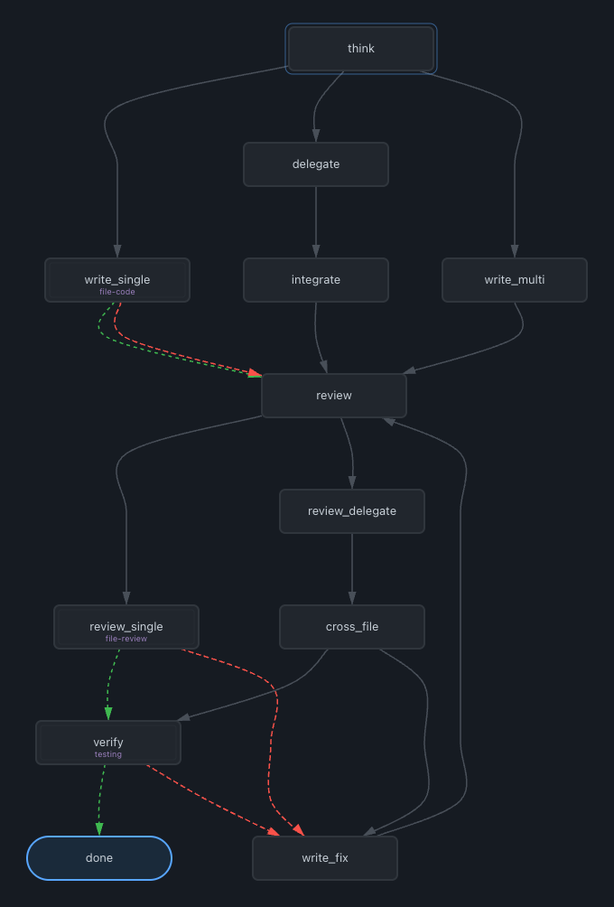
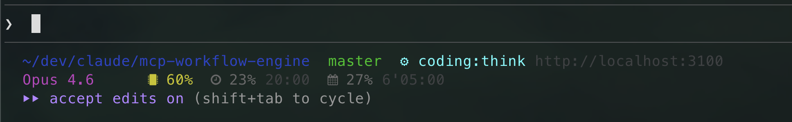

<p align="center">
  
</p>

<p align="center">
  <a href="https://www.npmjs.com/package/claude-mcp-workflow"></a>
  <a href="LICENSE"></a>
  <a href="https://www.typescriptlang.org/"></a>
  <a href="https://code.claude.com/docs/en/plugins"></a>
</p>

A Claude Code plugin that drives agents through YAML-defined state machines. The engine tracks state, enforces guards, manages nested sub-workflow stacks, and visualizes everything in a web dashboard.



## Features

- **FSM-based state machines** — define workflows in YAML with states, transitions, and prompts
- **Stack-based sub-workflows** — states can push nested workflows (max depth 10), auto-pop on completion
- **Three-tier loading** — bundled templates < global (`~/.claude/workflows/`) < project (`.claude/workflows/`)
- **Snapshot isolation** — workflow definitions frozen at session start; hot-reloads don't affect running sessions
- **Runtime overlays** — modify workflows on the fly without touching YAML files
- **Action states** — `exec` runs shell commands, `fetch` makes HTTP requests, with auto-routing by exit code or HTTP status
- **Web dashboard** — real-time session monitoring with DAG graph visualization
- **20 bundled workflows** — complete agent lifecycle from routing to reflection, including long-running batch orchestration and a text-only `docs` route
- **28 bundled skills** — reusable knowledge modules auto-provisioned on first run
- **SessionStart hook** — auto-provisions missing skills and injects workflow context
- **Pool gate** — a PreToolUse(Bash) hook runs the commands a project marks heavy (`.claude/workflows/pool-gate.yaml`) under `wf-run`, so agents' own test runs and builds share the machine-wide thread pool too
- **Agent types** — the plugin ships subagent types in `agents/`: `workflow:driver` (haiku/low; the task-driver rules, workflow tools only), `workflow:recon` (sonnet/medium) and `workflow:reviewer` (opus/high), both read-only: no Edit tool, a Write tool limited by a PreToolUse(Write) hook to the task report directory (absolute path in scratch space with a `<task>.log` / `<task>-logs` directory in it, outside any git work tree, no `..`; a write inside the worktree is refused), and a PreToolUse(Bash) hook (`hooks/read-only-gate.sh`) refuses a Bash call made by those types unless every pipeline segment starts with a declared reader (an ALLOW list: `ls cat head tail wc rg grep jq find git log/show/diff/status/grep/blame…` plus the config `read` list; `envAllowed` names the variables a `NAME=value cmd` prefix may set (any other assignment is refused; `GIT_*`, `PAGER`, `LD_*`, `DYLD_*`, `PATH`, `BASH_ENV`, `ENV`, `IFS` stay refused even when listed); `$( )`, backticks, brace expansion (nested `{{},-i}` included), `printf -v`, a variable in a command word, a variable or glob as a redirect target, a descriptor duplicate that is not the whole word (`>&1foo` writes the file `1foo`), `perl -i`, `python -c`, `node -e`, `tee`, `dd`, `cp`/`mv`, `find -delete` are refused) and any write (redirects into the tree, `git commit/add/rm/mv/stash/reset/checkout…`, `sed -i`, `rm/mv/cp`, plus the project's `.claude/read-only-commands.yaml`: `{ "read": ["apq"], "write": ["apq patch", "/regex/"], "env": { "APQ_READ_ONLY": "1" }, "envAllowed": ["APQ_TEST"], "agents": [...] }`) and, only when a segment starts with a project `read` CLI, exports `env` before the command (other allowed calls pass unchanged). Measured (a real `claude -p` run with a dumping PreToolUse hook, 2026-11-07): the payload of a subagent's Bash call carries `agent_id` and `agent_type`, the main session's carries neither, so it is never touched. Measured again 2026-11-08 with a real `workflow:recon` agent: a write-class Bash call was refused, so the payload carries the qualified name and the gate compares `agent_type` exactly against `agents` — default `workflow:recon`, `workflow:reviewer`; a bare `reviewer` or `other:reviewer` is never matched unless a project lists it. For a read-only agent the read-only hook owns the single rewrite: it exports `env` (only for a project `read` CLI), then applies the pool gate to the prefixed command (`pool-gate-hook` stays out), so a wrapped heavy command still carries the variables; a rewrite it emits carries `permissionDecision: "allow"` (auto mode refuses an unallowed rewritten call) only when every segment is a project `read` CLI, a default that reads no file (`cd echo printf pwd test date basename dirname true false`) or a stdin filter behind a pipe with no file operand (`head tail wc sort uniq cut nl tac tr grep rg`; for grep / rg the value of a value-taking flag is not an operand, so `grep -C 3 x` and `rg -m 5 x` qualify while `grep -C 3 x f` does not; never behind `xargs`, never with `--files0-from`): the allow skips the permission system for the whole call, so a call that needs the rewrite (a project reader's env export, a pool wrap) and carries a file-reading default (`hxq lint a.hx; cat ~/.ssh/id_rsa`, `hxq lint a.hx | xargs head`) is DENIED with `run it in its own call` — the env is neither dropped silently nor exported without an allow. **What this gate is and is not**: it guards a reviewer / recon against ACCIDENTAL writes, not an adversary — shell parsing cannot close every path. The guarantees are exactly three: no Edit tool and a Write limited to the report directory, the project's CLI read-only env, and the allow list of readers above. Out of scope, named: a reader reached by a path (`./ls`, `/tmp/x/cat` — judged by its base name), a flag injected by an inherited variable (`sort $FLAGS`; an allowed call cannot set one), an allowed reader that is itself scriptable, a file the call reads that it should not. A rewrite by a hook outside the plugin (e.g. RTK's own) is not composed — Claude Code keeps one `updatedInput` — so the refusal list is the guarantee and the env is defence in depth. A project extends a type in its own `.claude/agents`. Takes effect after a Claude restart
- **Survives a restart** — when Claude Code exits, its sessions are suspended, not abandoned; `claude --resume` continues them (`resume`), sub-agents included, and an exec that was running keeps running and is taken over

## Quick Start

### From Community Plugins (recommended)

The plugin is listed in the [claude-plugins-community](https://github.com/anthropics/claude-plugins-community/) catalog:

```bash
/plugin marketplace add https://github.com/anthropics/claude-plugins-community
/plugin install workflow
```

### From this repository

The repository is its own marketplace (`.claude-plugin/marketplace.json`):

```bash
/plugin install workflow --marketplace AxGord/claude-workflow
```

A local checkout works the same way: `claude plugin marketplace add /path/to/mcp-workflow-engine`, then
`claude plugin install workflow@claude-workflow` — the plugin is then read from the checkout itself (edit, then
`/reload-plugins`). Install it from a folder that IS the plugin, not through a symlink to it: the hooks module
(`hooks/plan-pane.tsx`) must resolve inside the marketplace folder.

### From npm

Create a `marketplace.json` and add it as a source, or install directly:

```bash
# 1. Add a marketplace with this plugin
/plugin marketplace add <marketplace-with-workflow>

# 2. Install
/plugin install workflow@<marketplace-name>
```

See [Creating a marketplace](https://code.claude.com/docs/en/plugin-marketplaces) for how to set up an npm-based marketplace with this plugin:

```json
{
  "name": "workflow",
  "source": { "source": "npm", "package": "claude-mcp-workflow" }
}
```

### Manual (for development)

```bash
git clone https://github.com/AxGord/claude-workflow.git
cd claude-workflow
npm install
npm run build
claude --plugin-dir ./
```

### Install channels

Supported marketplace sources: the **npm package** (`claude-mcp-workflow`) and a **local directory**. A marketplace entry that points at the git repository (git URL as a plugin source) is **not** supported — `build/` is gitignored, so a git-sourced install has no compiled MCP server to run. (Cloning for development works — see above — because you run `npm run build` yourself.)

## Recommended CLAUDE.md Snippet

The engine only helps when the agent actually starts a workflow. Add this to your `~/.claude/CLAUDE.md`:

```markdown
- **ALWAYS** start every conversation by calling `mcp__plugin_workflow_wf__start()` (no arguments) before doing anything else, including answering the user
  - **EXCEPTION**: If you are a sub-agent spawned by the Task tool, do NOT call `start()` without arguments — the parent agent manages the workflow session. Follow the start instructions from the parent's preamble instead
```

## Recommended Permissions

Auto-allow the workflow tools so the agent is not interrupted with a permission prompt on every transition. In `~/.claude/settings.json`:

```json
{
  "permissions": {
    "allow": [
      "mcp__plugin_workflow_wf__list",
      "mcp__plugin_workflow_wf__start",
      "mcp__plugin_workflow_wf__status",
      "mcp__plugin_workflow_wf__transition",
      "mcp__plugin_workflow_wf__context_set",
      "mcp__plugin_workflow_wf__modify",
      "mcp__plugin_workflow_wf__create",
      "mcp__plugin_workflow_wf__delete",
      "mcp__plugin_workflow_wf__sessions"
    ]
  }
}
```

`abort` is deliberately **not** allowlisted: sub-agents inherit permissions, and an auto-allowed `abort` would let a sub-agent silently kill its parent's session. Keep it behind a manual prompt.

## How It Works

```
Agent                       Engine                          Storage
  │                           │                               │
  ├── start() ───────────────►├─ snapshot workflows ─────────►├ session.json
  │◄── initial state prompt ──┤                               │
  │                           │                               │
  ├── transition() ──────────►├─ validate & advance ─────────►├ update JSON
  │◄── new state prompt ──────┤  (push/pop sub-workflows)     │
  │                           │                               │
  ├── transition() ──────────►├─ terminal state? ────────────►├ mark complete
  │◄── done ──────────────────┤  (auto-pop to parent)         │
```

1. `start()` — creates a session, snapshots all workflow definitions, returns the initial state prompt
2. `transition()` — validates the transition, advances state, handles sub-workflow push/pop, returns the new prompt
3. Every mutation is atomically persisted to JSON (temp file + rename + lockfile)
4. Dashboard visualizes sessions and workflow graphs at `localhost:3100`

## Workflow YAML

```yaml
name: my-workflow
description: "Example workflow"
initial: start
max_transitions: 50

states:
  start:
    prompt: "Analyze the task and decide on approach"
    transitions:
      implement: write_code
      explore: research

  research:
    sub_workflow: explore        # pushes nested workflow
    on_complete: write_code      # returns here on success
    on_fail: start               # returns here on failure

  write_code:
    prompt: "Write the implementation"
    transitions:
      done: finish

  finish:
    terminal: true
    outcome: complete            # or "fail"
```

## Action States

### Restart: suspend and resume

When Claude Code exits (SessionEnd), its active sessions and their active descendants are **suspended**: stack, context and children stay, no ledger line is written. The SessionStart hook records which conversation each process runs (`$STATE_DIR/claude-session-<pid>`); the server stamps it on every session it starts, and SessionEnd stamps the ending one.

- **`claude --resume` / `--continue`** keep the conversation id, so the SessionStart hook (`source: "resume"`) PICKS UP that conversation's sessions by itself — the suspended ones and those a crash left to a dead process, with their sub-trees (a descendant another live process runs, or a session whose parent is active elsewhere, stays where it is): through `build/session-cli.js` it hands each to the new process under the session files' locks (`Storage.update`) and clears every suspension. Its output names each picked-up session (`picked up: <session> @ <workflow @ state>`) and, below it, the sub-agent sessions with the `SendMessage` that wakes each agent — only the main agent can send it; the agent continues its session with `status`, no `resume`. A session below it with no `agent_id` on itself or on any session up to the root (e.g. a pipeline the main agent runs itself) is taken for the main agent's: one line `<session> → <state> — no agent linked — yours, unless a sub-agent you spawned runs it (then link_agent + SendMessage) → status({ session_id })`. The action step a session stopped in is named apart: `exec in flight`, `exec finished while no server ran`, `exec killed by the restart` (no process, no exit code), `step interrupted before its exec started`. That step is finished by the first `status` / `transition` of the session (a `transition` then is not taken — it answers as an error with the state the session moved on to): a running exec is waited for, a finished one gives its recorded result, and one killed or never started runs again — the engine writes `pending_action` before an exec waits for its pool lease or spawns, so a server gone in between (e.g. waiting for a `resource:` lease) leaves the step to run again, lease wait included. A previous server still alive (Claude crashed, the server did not exit) that gets its lease after the session left it — suspended or owned by another process — gives the lease back without starting the exec (`ExecContext.mayStart`). Not covered: a `fanout:` whose shards already run in such a surviving server (the rerun runs beside them), and a restart of the MCP server inside the same Claude process with the old one still alive (the same pid — `mayStart` cannot tell them apart). `status` of a session sitting in an action state names it (`[exec state "<s>": running in this server | running in PID … | begun by a server that is gone … | not running …]`) instead of `[sub_workflow: unknown]`. Without a build or node the hook lists the suspended roots for an explicit `resume` instead. A fresh `startup` picks up and lists nothing.
- **`/compact`** (and `/clear`): the hook's output becomes part of the new context, so it prints this process's active sessions as a tree (id, workflow @ state, the stack when nested, agent, the action step it stopped in) — a compacted orchestrator knows where it is.
- **`resume({ session_id })`** — the explicit path (startup, another account, `--fork-session`) — hands the session and its sub-tree to the current process and returns the session's state. Its suspended sub-agent sessions are listed as agent → session → state, each with the `SendMessage` that wakes its agent; the agent continues ITS OWN session with `resume`, not a new `start`. A suspended child no agent drives (no `agent_id` up to the resumed session) is taken for the caller's: `no agent linked — yours, unless a sub-agent you spawned runs it (then link_agent + SendMessage) → resume({ session_id })`. `link_agent({ session_id, agent_id })` records which agent drives a child session (call it after the spawn, once the child's session id is known), and the parent's state and visit it was linked at (see `driver:`).
- **Another account** (the conversation cannot be resumed), or `--fork-session` (a new conversation id — the SessionStart hint lists nothing): `suspended()` lists the suspended sessions of this project (git root of the server's cwd; `all: true` for every project) — `resume` any of them.
- **An exec in flight**: every foreground exec runs detached in its own process group, its output in files and its exit code written to a file when it ends (`$STATE_DIR/exec/`), so it outlives the server; the session records it (`running_exec`) while it runs. `resume` of a session stopped in that exec state finishes it: still running → waits (abort kills it; its `timeout` counts from its start); finished → takes the recorded exit code and output; neither (the machine rebooted) → runs the step again. Its pool lease lives while its process group does. A `fanout:` state runs again. The run dir is owner-only (0700); server start removes run files older than a day that no session references. The output files are not capped while the command runs (`yes` writes until its `timeout`) — only the tail of `max_output` BYTES is read back.
- A crash that skipped SessionEnd: the next server start suspends the sessions of dead processes. A session suspended longer than `WF_SUSPENDED_TTL_DAYS` (default 7) is abandoned at server start, with its ledger line.
- `transition` / `context_set` / `modify` refuse a suspended session and name `resume`.

States can run shell commands or HTTP requests automatically — the agent doesn't participate, the engine handles execution and routes to the next state based on the result.

### `exec` — run a shell command

```yaml
run_tests:
  type: exec
  command: "npm test"
  cwd: "{{context.cwd}}"
  timeout: 30000
  on_success: analyze
  on_error: fix
  success_prompt: "Tests passed:\n{{stdout}}"
  error_prompt: "Tests failed (exit {{exit_code}}):\n{{stderr}}"
```

An exec without `cwd:` runs in the session's cwd (`start`'s `cwd`, else the server's); a relative `cwd:` resolves against it. Its env carries `WF_PLUGIN_ROOT`, `WF_SESSION_ID`, `WF_PARENT_SESSION_ID` (empty at the root), `WF_ROOT_SESSION_ID`, `WF_PRIORITY` / `WF_PRIORITY_LEVEL` (the session's priority, below), plus `WF_THREADS` under a `resource:` lease with threads (below). Every exec runs in its own process group: a timeout, `abort`, or a parent's abort cascade kills `sh -c` together with everything it started. A foreground exec writes its output to files, not pipes to the server, and resolves when its shell exits — a background child it left behind keeps running, but no longer holds the step open; a command killed by a signal exits 128+signal; on `timeout` the group gets SIGTERM, then SIGKILL after 5 s if anything in it is still alive, and the step resolves only once the group is gone (a lease is released with it). `max_output` counts bytes of the output's tail. The history entry records `exit_code` and `duration_ms`.

### Heavy work — the machine-wide thread pool

A `transition` / `start` / `resume` / `status` call that waits for an exec (pool lease queue included) sends an MCP progress notification every 60 s (`waiting for pool lease (Ns)` / `running <state> (Ns)`) when the client gave a `progressToken`, so Claude Code's no-response timeout does not cut the call.

Light commands run as plain execs and never wait. Heavy ones (test suites, release builds, corpus runs) take a lease from one pool shared by every session, project and Claude config dir on the machine — `$WF_POOL_DIR`, default `~/.claude/workflow-pool` (deliberately not under `CLAUDE_CONFIG_DIR`):

```yaml
run_suite:
  type: exec
  command: "npm test"
  resource: { threads: 6, priority: 0, wait_timeout: 900 }
  cases: { "0": analyze, "75": machine_busy }
  default: fix

test_wide:
  type: exec
  command: 'vitest run --maxWorkers="$WF_THREADS"'
  resource: { threads: { min: 2, max: budget }, wait_full: 60 }   # flexible: 2..budget threads
  on_success: done
  on_error: fix

dev_server_smoke:
  type: exec
  command: "npm run e2e"            # binds the fixed port 3000
  resource: { threads: 2, locks: ["port:3000"] }
  on_success: done
  on_error: fix
```

The same admission is a CLI for shell steps and agents' own commands (`bin` of the package; `scripts/wf-run` for execs: `"$WF_PLUGIN_ROOT/scripts/wf-run"`):

```bash
wf-run [--threads N|budget|MIN-MAX [--wait-full SEC]] [--lock NAME]… [--priority P] [--wait-timeout SEC] [--est SEC] [--label TEXT] [--efficiency] [--fail-open] -- <cmd> [args…]
wf-run --status    # one line per lease and waiter
```

**The lease only counts threads — the command must actually use that many.** Compilers, test runners and optimizers take every core by default, whatever the lease says. The leased command gets `WF_THREADS` = the threads granted (after `budget` and the clamp to the budget); pass it on: `make -j"$WF_THREADS"`, `vitest --maxWorkers="$WF_THREADS"`, `HXCPP_COMPILE_THREADS="$WF_THREADS" haxe build.hxml`, `oxipng -t "$WF_THREADS"`, `APQ_ORACLE_PARALLEL="$WF_THREADS"`. It is set only for a lease with threads — never for a light exec, a lock-only lease or `--efficiency` (an inherited value is dropped). It is env only, not a template variable: write `$WF_THREADS` in the command.

- **Admission** (under a proper-lockfile lock on `<pool dir>/pool.json`): `held + N <= budget`, and beside a live lease also `held + N + external <= budget` — external load never blocks an EMPTY pool (a head with N ≥ budget would otherwise wait forever on background load). `external = max(0, load − own − load_threshold)` is the load not taken through the pool, where `own` sums over the leases with threads the larger of a lease's threads and what its own process tree runs (below).  `load` is measured from cpu ticks (`os.cpus()`): busy cpus over the window since the pool's previous pass (≥ 0.5 s; a window over 5 s is stale and restarts); without a window (first pass, stale) it falls back to `loadavg1`, which is conservative — it lags a minute and still holds load that has ended. `<pool dir>/config.yaml` (optional): `budget` (default: performance cores − 2 — `hw.perflevel0.physicalcpu` on macOS, else `os.cpus().length` − 2, at least 1), `load_threshold` (default 2: the noise floor of light work) and `starve_after` (seconds, default 900 — below).
- **A lease's own load**: a lease records its command's process group (`wf-run`'s child, an exec's `sh -c`); each pass reads the process table (`ps`, at most once a second per process, outside the pool lock; a failed read is not retried for 30 s and leaves the trees unmeasured) and sums the busy cpus of the group's members and their descendants — another lease's group excluded, so a `wf-run` nested in a leased exec counts once, as its own lease. That tree is the lease's own load, never `external`: a lease of 4 threads whose command spawns twelve busy compilers no longer reads as 8 cores of foreign load that admits nobody (the incident behind this: `budget 10, held 4, load 13.77 (external 7.8)`, seven waiters for two hours). A tree below its threads still counts as its threads; a lock-only lease takes no threads, so what it runs stays external. A tree that runs at least `max(2, threads/2)` cpus over its threads is OVERRUN: `--status` / `pool_status` show `holds 4 threads, runs ~12 (OVERRUN)`, a waiting `wf-run`'s progress line names it beside its holder (`label (4, runs ~12)`), and `<pool dir>/pool.log` gets one line per lease. **An over-running lease is no longer bounded by admission**: the pool only keeps the threads it hands out within the budget (`held ≤ budget`), so while a lease runs 12 cpus on 4 threads the waiters are still admitted and the machine is oversubscribed. The lease is flagged and logged, not throttled — the fix belongs to the command that ignores `WF_THREADS`: pass it on. CPU per process is the kernel's recent average on macOS, the lifetime average on Linux.
- **Starvation**: a waiter queued `starve_after` or longer is STARVED, and so is a pool with waiters that granted nothing that long. `--status` / `pool_status` mark the waiter (`since … (Ns, STARVED)`) and print `STARVED: nothing granted for 2h10m, 7 waiting (held 4/10, external 7.8; over-running: pid … holds 4, runs ~12)` under the header; `pool.log` gets one line per waiter; a waiting `wf-run` adds `— STARVED: queued 17m` to its progress line. An exec waiting on a lease checks every 10 s: once starved, its session records it (`pool_starved`) until the lease is granted or the step ends — the MCP progress heartbeat says `waiting for pool lease (Ns) — STARVED: <why>`, `sessions` marks the session `[POOL STARVED since …]`, and `status` / `transition` of the session or any ancestor start or end with `POOL STARVED: session <id> (<workflow @ state>) waits for a pool lease since … — <why>`, so the parent sees it at its next call while the starved child's own call is blocked.
- **Named locks**: `resource: { locks: [NAME, …] }` / `--lock NAME` (repeatable) — machine-wide mutual exclusion by name (one word, no whitespace: `port:3000`, `ios-simulator`; a name may template a session value — `"{{context.cwd}}-land"` — and whitespace it renders becomes `_`), for dev servers, bridges and anything else on a fixed port or a single device. `threads` is optional beside `locks` (a lock-only lease takes no threads and is never blocked by load; `wf-run --lock` without `--threads` is lock-only), at least one of the two is required. Locks and threads are granted ATOMICALLY in one pass: a task gets everything it asked for or keeps waiting holding nothing — no partial hold, so no deadlock between two tasks wanting the same pair. A dead holder is reaped like any lease; `abort` withdraws a lock wait; `--status` lists held locks; `wait_timeout` → 75.
- **Order**: priority descending, then arrival; a lock goes to its waiters in queue order. The first waiter that fits by locks but not by threads is the **head**: a later task starts ahead of it (**backfill**) only when that cannot delay it: its estimated run ends before the threads the head waits for (its minimum; a flexible head inside its `wait_full` window: its max) are expected free. The estimates are the p90 of the step's last successful runs on the same threads in the ledger (at least 3, within 30 days; a flexible or `fanout:` step has none) or `wf-run --est SEC`; the head's start is when the running leases' estimated ends free its minimum (a lease with no estimate, past it or over-running ends at an unknown time). No estimate on either side: strict order, a smaller task never overtakes the head — starved or not. A lease backfilled past a head that runs twice its estimate stops backfill past that head (`backfill off:` in `pool.log`; each backfill is a `backfill:` line). Nothing is preempted. A waiter blocked by a held lock claims no threads, so a long-held lock (a dev server) does not stall the rest of the queue. `N` above the budget counts as the budget: it waits for an empty machine and runs alone. `threads: budget` / `--threads budget` asks for the whole budget as `config.yaml` sets it when the request is made — no hardcoded core count in a workflow.
- **Priority levels**: a session has a level — `low` (−100), `normal` (0, the default), `high` (100), `urgent` (200) — set by `start({ priority })` and inherited by its child sessions (an explicit `priority` on a child's `start` overrides it for that subtree). A lease's priority = the session level + the step's own `resource.priority`, so a step fine-tunes within its level (keep it under ±100). `set_priority({ session_id, level })` changes the level of a session and of its active descendants at once (later children inherit it) and re-ranks their WAITING pool entries in the same pass; running leases keep theirs — there is no preemption. Every exec gets `WF_PRIORITY` (that sum) and `WF_PRIORITY_LEVEL`; `wf-run` without `--priority` queues at `WF_PRIORITY` and keeps the level, so a nested `wf-run` is re-ranked with its session. Two windows keep the old level: an exec whose context was built just before `set_priority` but had not yet joined the queue waits at the old level until it is granted, and a `wf-run` inside an exec started before `set_priority` takes that exec's old `WF_PRIORITY`. An explicit `--priority P` is the whole priority and has no level. `set_priority` is for the user's request — an agent never raises its own session or changes another project's.
- **Flexible threads**: `threads: { min: A, max: B|budget }` with `wait_full: SEC` (default 0), or `wf-run --threads A-B [--wait-full SEC]` (`B` may be `budget`). The waiter gets `B` when `B` fits; otherwise, once `wait_full` seconds have passed since it queued, it takes every thread that fits if that is at least `A`. `WF_THREADS` = the threads granted. Order is unchanged: while a flexible head waits — for `B` inside its window, or for `A` after it — it closes the threads to everyone behind it like any waiter (the window waits for threads being freed; a smaller task taking them would defeat it). `A`/`B` above the budget clamp to it. `wait_full` without a `{ min, max }` is a load error, `--wait-full` without a range a usage error. `threads: N` is `{ min: N, max: N }`.
- **Status**: `wf-run --status` and the `pool_status` MCP tool print the budget, the load (and a `STARVED:` line, above) and one line per lease and per waiter (in admission order): `pid`, what it holds or wants (`holds 6 threads (asked 2-8) + lock sim` / `wants 2-8 threads`, `, runs ~N (OVERRUN)`), `prio` with the level, `since HH:MM:SS (Ns[, STARVED])`, the project (the git root of its cwd, a linked worktree mapped to its main repo, `~`-shortened), `session`, `step` (`workflow/state`) and the label (the command).
- **Reaping**: leases and waiters whose pid is dead are dropped on every pass. A lease lives while its pid OR its recorded process group does. A `wf-run` lease owns its group: a SIGKILLed `wf-run` cannot release, and its child runs detached in a group of its own — so the next pass that finds the `wf-run` dead SIGTERMs that group (one `orphan:` line in `pool.log`), SIGKILLs it once it outlives a 3 s grace, and frees the lease when the group is gone. The group is recorded with the boot it ran under and its leader's start time (`ps -o lstart`): a lease from another boot, or whose pgid now leads another process (the pid wrapped), is dropped without signalling anything. A driver that SIGKILLs a job's `wf-run` therefore leaves no live child and no lease behind (it needs some pass: any waiter, `--status` or `pool_status`). An exec's group is NOT killed when its server dies: the run survives for the resumed session to adopt, and its lease lives with it. A waiter polls each second and wakes at once when `pool.json` changes; `wf-run` prints a progress line to stderr when it starts waiting and every 30 s.
- **Busy**: no lease within `--wait-timeout` / `wait_timeout` → exit **75** (EX_TEMPFAIL). An exec routes it through `cases`/`on_error`; its `timeout` counts the run only, and `wait_ms` is recorded beside `duration_ms` in the history and the ledger, together with `threads_granted` and `step_key` (below). `abort` withdraws a waiting exec. `resource:` is for foreground execs only (a load error on `background: true` or a fetch).
- **`wf-run`**: the child runs in its own process group with inherited stdio; `--status` measures over a 0.6 s tick window; SIGINT/SIGTERM/SIGHUP are forwarded to the group; the exit code is the child's; the lease is released on exit. `--efficiency` (macOS) runs the command under `taskpolicy -b` (efficiency cores, low priority) outside the budget — its `--lock`s still hold; elsewhere it warns and goes through the pool. `--fail-open`: when the pool itself cannot be used (dir not writable or not creatable, broken `config.yaml`, lock not taken) the command runs without a lease, `WF_THREADS` = the smallest share asked, plus one stderr line — busy still waits; without it such a failure is exit 1 and the command never starts.

#### Pool gate — agents' heavy Bash commands through the pool

Agents do not call `wf-run` themselves. The plugin's PreToolUse(Bash) hook (`hooks/pool-gate.sh` → `build/pool-gate-hook.js`) rewrites a command the project marks heavy into `<plugin>/scripts/wf-run --fail-open --threads <N|MIN-MAX> --label '<command>' -- <shell> -c '<command>'` (absolute path, not `PATH`; `<shell>` = the Bash tool's `$SHELL` when it is sh/bash/zsh/dash/ksh, else `sh`). What is heavy is decided ONLY by the project's `.claude/workflows/pool-gate.yaml`, the nearest one from the command's cwd up to the git root (none outside a git repo). No config, or no rule hit → the command is untouched and the hook says nothing; the no-config case is decided in the shell script itself (no node started), so a project without a `pool-gate.yaml` pays a few milliseconds per Bash call. Example (a sample — the plugin creates no project config):

```json
{
  "rules": [
    { "match": "npx vitest run", "threads": "2-8", "pass": "--maxWorkers=$WF_THREADS" },
    { "match": "npx vitest", "deny": "watch mode never ends under the pool — use `npx vitest run`" },
    { "match": "/^turbo run (build|test)\\b/", "threads": 6, "pass": "--concurrency=$WF_THREADS" },
    { "match": "haxe", "threads": 4, "pass": "env:HXCPP_COMPILE_THREADS" },
    { "match": "make", "threads": "2-6", "pass": "-j $WF_THREADS" }
  ],
  "wrappers": ["build-run.sh", "app-run.sh"]
}
```

- **`match`**: the leading words of a simple command (the first word also by basename: `haxe` hits `/opt/bin/haxe`; leading `VAR=x`, `env`, `time`, `exec`, `!` and `if`/`then`/`do` … are skipped), or `/regex/flags` tested on the command's text. The first rule that hits a segment wins, so put `npx vitest run` before the `npx vitest` refusal.
- **`env`** (optional): conditions on the segment's leading assignments (`NAME=value` before the command, also after `env` / `time` …), all of which must hold for the rule to hit — `true` = set (any value, empty too), `false` = not set, `"/regex/flags"` = set and its unquoted value matches. `match` alone cannot tell `APQ_TEST=unit. node bin/test.js` from a bare `node bin/test.js` (it sees the text from the command word on); `{ "match": "node bin/test.js", "env": { "APQ_TEST": true }, "threads": 1 }` before `{ "match": "node bin/test.js", "threads": 8 }` can. Only the segment's own assignments count — not `export` in an earlier segment, not the hook's environment.
- **`threads`**: `N` or `"MIN-MAX"` (a flexible lease, `WF_THREADS` = what was granted). **`pass`** (optional) tells the command its share: a flag holding `$WF_THREADS`, put after the matched words (a regex hit: at the end, or before a `--` word when there is one) unless the command already gives that flag (`-j 2`, `-j8`, `--concurrency=2` stay), or `env:NAME` → `env NAME="$WF_THREADS"` in front of the command. `$WF_THREADS` is expanded by the shell under `wf-run`.
- **`deny`**: instead of `threads` — for what does not belong in a queue (watch modes, dev servers); the call is refused with the reason (`permissionDecision: deny`). Order: a segment that runs `wf-run` or a `wrappers` script is never matched against the rules, `deny` included — its command already runs under a lease, by an explicit choice (the gate's own wrapped form too, so a `/regex/` needs no `^` anchor to keep off it); every other segment of the same command is still matched, and a `deny` hit there refuses the whole call.
- **`wrappers`**: project scripts that take their own lease (they call `wf-run` inside); a command running one is never wrapped again. A wrapper that takes no lease is not listed — a rule matching its name wraps the whole call, the script stays unchanged.
- **Splitting**: quotes, escapes, `$( )` and backticks are honoured; segments split at `&&` `||` `;` `|` `(` `)` and newlines. A hit anywhere wraps the WHOLE command under ONE `wf-run` with the largest share any hit asks (mins and maxes each take their largest) — simpler and safer than cutting a shell line apart (redirections, pipes, `cd` all keep working; segments run one after another, so the largest is enough; a pipe of two heavy commands is under-counted). A heavy command inside `$( )` is not seen.
- **Left alone**: `WF_THREADS` already in the hook's environment (Claude Code itself runs under a lease), a command holding `wf-run` or a `wrappers` script anywhere (a nested lease could wait on its own outer one), a background `&` (the lease would end before the work), a heredoc or an unterminated quote (not plain enough to edit).
- **Bypass**: `WF_POOL_BYPASS=1 [WF_POOL_BYPASS_REASON='…'] <command>` — untouched, one stderr line naming the reason.
- **Output**: unchanged — `wf-run` writes only to stderr (waits, progress) and exits with the command's code; the gate passes no `--wait-timeout`, so a busy pool means a wait, never exit 75. A Bash call that reaches its own timeout while waiting is moved to the background like any long command, not killed.
- **Never breaks Bash**: no node, no build, a broken `pool-gate.yaml` or any error in the gate → the command passes as it is plus one stderr line. `--fail-open` does the same for the pool: a pool `wf-run` cannot use (an unwritable or uncreatable `$WF_POOL_DIR` — a sandbox, a read-only `~/.claude` —, a broken `config.yaml`, a lock it cannot take) runs the command without a lease, `WF_THREADS` = the smallest share asked, plus one stderr line. Busy is not a failure: it waits.
- **With RTK**: Claude Code (2.1.312) keeps the LAST `updatedInput` of parallel PreToolUse hooks, which is almost always this gate's — RTK's own rewrite of the same command would be lost. So when `rtk` is on `PATH` the gate puts the body through `rtk rewrite` itself, from the command's cwd: exit 0 → RTK's rewrite and `permissionDecision: "allow"` (RTK checked that the user's allow rules cover every command in the chain — the decision Claude Code would take on the original line, whereas its own check sees the rewritten one); 3 → RTK's rewrite, no decision; 2 (a deny matched) → the gate leaves the whole command alone, so Claude Code's deny sees the original line; anything else → the body as it is. Without `rtk` there is no decision: the usual permission flow checks the rewritten line.
- **Never add an allow rule for `…/scripts/wf-run`**: `Bash(<plugin>/scripts/wf-run:*)` would allow ANY chain wrapped behind it, and the path changes with every plugin version anyway.
- **Limits**: the inner `<shell> -c` does not get the Bash tool's shell snapshot (aliases, functions, `setopt`); `npx -y …`, `sudo …`, `nice …` and commands inside `$( )` are not recognised; the config is found from the call's `cwd`, not from a `cd` inside the command, and a `cd` inside a wrapped command does not move the Bash tool's working directory.

### `fetch` — make an HTTP request

```yaml
check_api:
  type: fetch
  url: "http://localhost:8888/ping"
  method: GET
  timeout: 5000
  retry:
    max: 60
    interval: 500
  on_success: ready
  on_error: wait
  success_prompt: "API ready: {{body}}"
  error_prompt: "Not responding: {{error}}"
```

### Routing

Action states route via `on_success`/`on_error`, or by specific codes using `cases`:

```yaml
run_tests:
  type: exec
  command: "npm test"
  cases:
    "0": all_passed
    "1": tests_failed
    "2": no_tests_found
  default: unknown_error
```

An exec killed by its `timeout` exits 124. `on_timeout: <state>` routes that apart from every other
outcome (it wins over `on_error` and `cases`) — a gate that timed out on a loaded machine is not a
code defect and should not enter the fix loop. Foreground exec only; beside `cases: { "124": … }` it
is a load error (two routes for one outcome).

### Fan-out — one command, many shards

```yaml
suite:
  type: exec
  command: "npx vitest run --shard=$WF_SHARD"
  timeout: 600000                      # per shard
  fanout: { count: 4, threads_each: 3, max_parallel: 4 }
  on_success: green
  on_error: red
  on_timeout: slow_machine
```

The engine runs the command `count` times with `WF_SHARD=i/N` (1-based, `vitest`/`jest` `--shard`
form), or once per non-empty line `items_command` prints with `WF_ITEM=<line>`
(`fanout: { items_command: "ls test/suites", threads_each: 2 }`). Each instance takes its own lease of
`threads_each` threads from the pool (`WF_THREADS`), so shards start as threads free up and the
machine-wide budget holds; `max_parallel` caps the instances in flight (default: as many as the
budget runs side by side, `budget / threads_each` — the rest wait outside the pool queue, so other
sessions are not stuck behind the whole fan-out). Lines of `items_command` lose a trailing `\r`. `timeout` bounds
each shard. The step exits 0 only if every shard does; otherwise with the failing shards' common exit
code (all of them timed out → 124, which `on_timeout` routes), or 1 when they differ. `{{stdout}}` is
the summary — `fanout: 3/4 ok, 1 failed (exit 1)` and each failed shard's output tail. Abort kills
the running shards, withdraws the waiting ones and starts no more. History and ledger keep one
`shards` entry per instance (`shard`, `exit_code`, `duration_ms`, `wait_ms`, `threads_granted`).
`fanout` is a load error beside `background` or `resource`; a failing `items_command` fails the
step without running a shard.
Known limitation: a fan-out's leases take no `resource:` options — no `wait_timeout` (so no exit 75
route), no `locks`, no step `priority` (the session level only).

### Template variables

All prompts support `{{mustache}}` templates. Context values are available everywhere via `{{context.key}}`, as are `{{visits.<state>}}` (visit count in the active stack frame; empty if never visited), `{{root_workflow}}` (the workflow at the stack root, e.g. `subagent`), `{{session_id}}` and `{{parent_session_id}}` (empty at the root), `{{stale_sessions}}` (one `STALE:` line per stale session below this one — § Stall detection — or `none`; computed only when a template names it). After action execution, result variables are also available:

| Source | Variables |
|--------|-----------|
| `exec` | `{{stdout}}`, `{{stderr}}`, `{{exit_code}}`, `{{pid}}` (background), `{{wait_ms}}` (`resource:`) |
| `fetch` | `{{status}}`, `{{body}}`, `{{error}}` |

They come from the session's last action result (`last_action_result` in the session JSON), so they are not limited to the action's own `success_prompt` / `error_prompt` / `context_set`: the state an action routes into renders them in its own `prompt`, later prompt states still see them, and the next action state reads them in its `command` / `env` — until that action replaces them. `context_set` a value to keep it past the next action.

Action states can be chained — `exec` → `exec` → `fetch` → `prompt` — up to 20 steps without agent involvement.

### `revisit_prompt` — per-visit data on a revisit

On a revisit of a prompt state the engine sends only "Revisit #N — follow the instructions from your first visit". A state whose prompt carries per-visit data (for example the `{{stdout}}` of the exec before it) can set `revisit_prompt`, a template rendered with the same variables as `prompt`, shown on revisits instead of that line. Absent = the generic line. `status()` (and any forced full prompt) still returns the full `prompt`, and so does a state with `full_on_revisit: true` (it wins over `revisit_prompt`).

```yaml
dispatch:
  prompt: "Admitted:\n{{stdout}}\n1. ..."
  revisit_prompt: "Admitted:\n{{stdout}}\nSame steps as your first visit."
```

### Stations — the columns of the live workflow map

`/api/workflows` returns per workflow `stations: [{name, script, terminal}]`: the states on the shortest route from `initial` to the success terminal, in order; `script` is an exec state. The route follows the happy moves (`transitions`, `on_success`, `on_complete`, `cases["0"]`; every move when the terminal is out of their reach). The success terminal is the farthest terminal whose `outcome` is not `fail`, or the one terminal with `station: true` (a mark on a failure terminal, or on several terminals, is ignored and the loader warns on stderr). A state's `station: false` leaves it out (an exec helper such as `prepare` or a `*_route`); `station: true` adds a reachable state that lies off the route, placed by its distance from `initial`. Computed in `src/stations.ts`.

### Guards and the exhausted route

`max_transitions` (per workflow, per stack frame, default 50) and a state's `max_visits` refuse a move past them with an error. A move that only closes the run is exempt from `max_transitions`: one into a terminal, or into a state no route leads back to that leads on to a terminal (batch's `stop` -> `report` -> `finish`), so a run at its cap can still end cleanly. Within 5% of the cap every status / transition reply carries a `WARNING:` line naming what to do. The bundled `batch` sets 100000 (a queue loop takes about 3 transitions per task). A state may instead name where a move past its `max_visits` goes:

```yaml
fix:
  prompt: "Fix attempt {{visits.fix}}"
  max_visits: 3
  on_exhausted: escalate      # the 4th move into fix enters escalate instead
  transitions: { retry: verify }
```

The route applies to every move into the state — an agent `transition`, an action state's `on_success`/`on_error`/`cases`, a skill gate's auto-transition; a pop's `on_complete`/`on_fail` does not check `max_visits`. Chained routes are followed (an exhausted `escalate` with its own route goes on), a cycle is an error, and the history entry's `detail` names the exhausted states. A rerouted action move shows the routed-to state's own prompt, not the action's `success_prompt`/`error_prompt` (written for the default target); the result stays readable there as `{{stdout}}`/`{{exit_code}}`. `on_exhausted` without `max_visits`, or to an unknown state, fails the load. `{{visits.<state>}}` counts visits in the active frame, so the routed-to state can say how many tries ran.

### Question states — `ask: parent`

A state tagged `ask: parent` asks its parent session a question: entering it logs an `ask` event in the event log, leaving it an `answer` (the dashboard's live map draws the pair). A question from ANY state is asked through the context key `ask_parent` (a driver has no shell, so it is one `context_set`): the hand-back sets it to the reason, in the state the session stands in, and the pair is derived from the session alone — the question is OPEN while the key holds text and no move or end of the session came after the write that set it; the session's next move or end (the parent's own `transition` on the child: a regate, a close) or the key cleared to `""` (the driver, once the parent has answered) is the answer, `to` = the state it moved to (or the state it stays in). A stale key is ignored; the same text written again while the question is open is still one question, and a question asked after an answer is a new `context_set`. The bundled driver instructions (`agents/driver.md`, `templates/drivers/task-driver.md`) set it before a NEEDS-PARENT line and clear it on resume. Asked inside an `ask: parent` state it is that state's one question, with its text. The log is `GET /api/events?since=<run>:<seq>` and the SSE stream `/api/events/stream` (ids are `<run>:<seq>`; a position from another run — a server restart — restarts from 0). It covers only the server process that holds the dashboard port; other Claude Code servers write their own `events/run-*.jsonl` under the state dir, which the dashboard does not serve.

### Stall detection — `stale_after`

A session whose state saw no engine call (no `transition`, `context_set`, … — any write) for longer than the state's `stale_after` seconds is **STALE**: its agent may be dead or stuck. Unset, the state's type decides: a prompt state 1800 s (its agent calls the engine as it works), an `exec` / `fetch` 3600 s, a heavy exec (`resource:` or `fanout:`) 14400 s — an exec's default is never below its own `timeout` + 300 s, before which the timeout bounds it. `stale_after: 0` = never (a state that waits for the user); on a terminal or `sub_workflow` state it is a load error (never read). Never stale: an ended or suspended session (suspension is its own mark), a session with an active child (it waits for its children, each judged on its own), and a `resource:` / `fanout:` exec waiting for its pool lease (before its run began, or marked `pool_starved`) while the process that owns the session is alive — the pool's wait, reported as `POOL STARVED`; a dead owner's wait counts. The clock runs from the session's last write, or from the start of the state's run when that is later (`running_exec`, else `pending_action.run_at`, written when the step's first lease is granted — a `fanout:` has no `running_exec`), so a takeover, resume or `context_set` during a run resets it. A fetch or a light exec is timed from its last write.

- `sessions` marks one `[STALE: no engine call for 47m (since …), past its state's stale_after 30m]`.
- `status` of a session lists the STALE sessions below it on top (the session itself is its parent's `status` and `sessions`' to show) (`STALE: session <id> (<workflow @ state>, child of <parent>, agent <agent id>) — …`) with what to do once: SendMessage the agent; no answer → abort the session, or let a new agent continue it from `status` — the session holds the step, so a restart loses nothing. `transition` appends the same lines. A line the answer's prompt already renders (`{{stale_sessions}}`) is not repeated; a revisit's digest renders no prompt, so there they come back as the notice. A step run again (resume, an interrupted lease wait) drops its old `run_at`: its own first lease starts its clock.
- The bundled `batch` `collect` prompt lists the run's stale sessions (`{{stale_sessions}}`), so the dispatcher messages or restarts a stuck driver/worker; its `paused` state (waits for the user) is `stale_after: 0`.

```yaml
work:
  prompt: "Implement the change"       # a long single step: give it longer than the 30-min default
  stale_after: 7200
  transitions: { done: review }
```

### Strict schema

An unknown key in a workflow, a state, a `retry:`, `resource:`, `fanout:` or `model_table:` block fails that workflow's load (stderr names the file, the state, the key and the nearest known key) — a typo is never silently ignored.

### Ledger

Every session end (complete, fail, abort, cascade, expiry of a suspended session) appends one JSON line to `$STATE_DIR/ledger.jsonl`: ids (session / parent / root), workflow, outcome (`completed` / `failed` / `abandoned`), start/end time, transition count, the exec durations by state and their pool waits (`wait_ms`, `wait_ms_total`), and `segs` (each stretch of a state as `{s, a, b, w?}` in epoch ms, `w` the pool waits flat: what the Timeline tab draws a pruned session from). A `resource:` exec also records `threads_granted` (absent when it got no lease), a `fanout:` exec its `shards`, and both `step_key` = `<project>|<workflow>|<state>` (project = the git root of the session cwd, every worktree of a repo mapping to its main one) — the raw data a model of step time against threads keys its runs by; the engine only records it. From the session's context it also records `difficulty`, `claim_difficulty` (the first one the table saw; `wf-calibration` bands by it), `model`, `effort`, `escalations`, `review_model`, `review_effort`, `stages` (the `model` / `effort` each stage ran on: its row when a state reading `context.model_<stage>` was entered — or, in a prompt state, `context.model` / `context.effort` (execute) or `context.review_model` / `context.review_effort` (review); an exec's env does not count — first value wins — a later rescore does not replace it; only those rows, so a stage absent from the line did not run) and `tokens` (`tokens` → `total`, `tokens_<role>` → `<role>`, whole numbers only) when set — what a `model_table` is tuned from. It also records `spend`: the REAL cost of the task, summed at its end from the transcripts of every agent that worked on it (the session's linked `agent_id`, any context key `agent_id_<stage>` or `<role>_agent` such as `recon_agent` / `worker_agent` / `reviewer_agent`, over the session and all its descendants; `spend.agents` counts them), each turn priced by its own model id at input, output, cache-read and cache-write rates (`TURN_RATES_USD_PER_MTOK` in `src/calibration.ts`, keyed by model id with a family fallback for an unknown id of a known family; the Anthropic list of 2026-10-06; a 1-hour cache write costs twice the input rate) — a turn counted once, only inside the task's start..end window. An agent whose transcript cannot be read, or whose model has no rate, leaves `usd` absent and its id in `spend.unmeasured`: the task is unmeasured, never $0. An agent no key names (a replaced `agent_id`, a respawned worker) is counted in `spend.unnamed`: transcripts of the task's conversations active in its window, possibly a concurrent task's, so the figure is not presented as complete. Appends follow the session files' lock discipline with the ledger's own lock file; the ledger is never pruned with old sessions.

## Three-Tier Loading

Workflows load from three sources in ascending priority — later tiers override earlier ones:

| Tier | Path | Purpose |
|------|------|---------|
| Bundled | `templates/` (plugin root) | Base workflows shipped with the plugin |
| Global | `~/.claude/workflows/` | User customizations shared across projects |
| Project | `.claude/workflows/` | Project-specific workflows |

A project workflow named `coding` overrides the bundled `coding` template. Same-name global workflows sit in between.

The project tier is the server's cwd. A session started with `start({ cwd })` in ANOTHER project that has
its own `.claude/workflows/` (a worktree counts as its main checkout; the home dir, whose
`.claude/workflows` is the global tier, is none) sees the workflows that project defines itself laid by
name over the server's — a name only the server has is still found: a dispatcher in one repo can run a task by the
procedure another repo defines (a queue line's `repo:` + `workflow:`).

### `extends:` — inherit a workflow

```yaml
# .claude/workflows/testing.yaml
name: testing
extends: testing          # the global / bundled testing, never this file
states:
  project_test:           # replaces the base state of that name WHOLE
    type: exec
    command: "npm test -- --maxWorkers=$WF_THREADS"
    timeout: 600000
    resource: { threads: 6 }
    on_success: check_integration
    on_error: fix_unit
    on_timeout: suite_slow
  suite_slow:             # a new state joins the base's
    prompt: "The suite timed out — machine loaded? Re-run (`retry`) or report."
    transitions: { retry: project_test }
```

The definition is the base's, with the heir's states laid over it by name (a same-named state is
replaced whole, not merged key by key; new states are added). `initial`, `max_transitions` and
`description` come from the heir where it sets them. A heir extending its OWN name inherits that
name from the tiers below its file (project `coding` → global, else bundled `coding`); another name
resolves like any workflow name (the top tier). Chains work; a cycle, a missing base, or `extends`
of its own name with nothing below fail the load. Reference checks (initial, transitions, routes)
run on the merged result. Without `extends`, `initial` and `states` are required.

**Extension points.** The bundled workflows expose the steps a project usually wants to own as
states with contract names; bundled, each keeps the old behaviour (the agent does it, or nothing):

| State | In | Bundled default | Routes a heir's exec should keep |
|---|---|---|---|
| `project_test` | `testing` | prompt: the agent runs the tests via a runner subagent | `on_success: check_integration`, `on_error: fix_unit` |
| `project_build` | `testing` | prompt: build before integration | `on_success: integration`, `on_error: fix_integration` |
| `project_gate` | `testing` | exec `true` — no gate | `on_success: done`, `on_error: failed` (the caller's fix round) |
| `project_build` | `bug-fix` | prompt: build the fixed app before the visual check | `on_success: verify_visual`, `on_error: write_fix` |
| `project_prepare` | `batch-task` | exec: `git worktree add <repo>/../.wt/<repo-name>/<ID> -b batch/<ID>`; stdout = the path alone | `on_success: work`, `on_error: prepare_failed` |
| `project_land` | `batch-task` | exec under the lock `{{context.cwd}}-land`: `git merge --no-ff` + the queue's `land_test:` (red → the merge is taken back with `reset --keep`; unsafe → exit 4, nothing touched) | `cases: {"0": mark_done}`, `default: land_failed`, `on_timeout: land_failed` |

`coding` and `bug-fix` verify through `testing`, so one heir of `testing` serves both. Give every
heavy step `on_timeout:` and a state of its own for it.

### Task queue — `batch`, `queue_next`, `queue_add`, `wf-queue`

Which queue: every queue tool and `wf-queue` takes an optional `queue` NAME beside `file`. Neither =
the project's default `.claude/batch/queue.yaml`; `queue: "<name>"` = `.claude/batch/<name>.yaml`; a full
`file` path (a queue of another repo) still works. The project is the git root of the server's cwd (a
linked worktree resolves to its main checkout). `wf-queue [<file>|--queue NAME] …` reads the same way;
`--path` prints the resolved file. A missing file is an error naming the resolved path, except `queue_add`
(`--add`), whose first task CREATES the queue (only when addressed by name or by default, never a full `file` path) (`batch_size: 1`, `tasks: []`) and says so.

A long run of tasks is a YAML queue FILE the engine admits from — one format for every project. The
top-level keys are the header (any other key is free: `wf-queue --header <key>` reads it), `tasks:` the list:

```yaml
batch_size: 3                 # the window; 0 pauses
reason: three at once         # why the window is what it is (queue_header writes both)
base: [/abs/repo=<sha>]
land_test: npm test           # run after each merge (batch-task's default land)
record_file: records.md
overlap: files                # optional: only FILE entries of `touches:` conflict (default `paths`)
tasks:
  - id: T1
    status: pending           # pending | running | done | failed | backlog
    difficulty: 7
    kind: feature             # optional: bug | feature | research (absent = feature)
    touches: [src/engine]
    text: |-
      <self-contained brief>
  - id: T2
    status: pending
    model: sonnet
    repo: other-repo
    after: [T1]
    touches: [src/a, docs]
    owner: typer
    parked: true              # never admitted until unparked
    text: |-
      <brief>
    notes:
      - {from: user, date: 2026-11-07, text: later thought}
```

Task keys: `id, status, difficulty, kind, priority, model, effort, repo, workflow, after, touches, owner, exclusive,
breaking, parked, ended, text, notes`; `ended` (`YYYY-MM-DD`) is the day `queue_mark` moved the line to `done` or `failed` — written there, removed by a retry or any move out of those, read-only for `queue_add` / `queue_edit`; any other key, a bad status, a duplicate id or a malformed file is refused by
every read. Every write edits the parsed document in place: key order and comments stay.

Keep the queue file untracked and ignored (e.g. `.claude/batch/` in `.gitignore`): a tracked queue is
dirtied by the first pick, and `batch-task`'s land refuses a dirty tree (exit 3). The land takes a
merge back with `git reset --keep` only while HEAD is still that merge; otherwise (HEAD moved during
`land_test`, or local edits on the merged files) it exits 4 and touches nothing.

A pick fills the window (`batch_size` minus the running tasks) in `priority:` order (`urgent`, `high`, `normal` = default, `low`; file order within one priority) with the pending tasks
(never `backlog` ones) that:

- are not parent-run (`model: —`, or a repo-bound line with a `touches:` entry that git ignores in its repo: no worktree copy exists; `queue_next` names the path; an entry git cannot judge, e.g. one past a symlink, is judged alone and costs only itself) and not `parked: true`. `queue_add` / `queue_edit` warn on such an entry and on a file entry whose directory does not exist;
- have every `after:` id done (an id-like token that names no task, or prose beside the ids, is a
  condition for a human: never admitted);
- overlap no running and no just-admitted task: `touches:` paths overlap when one is a prefix of the
  other on a `/` boundary — compared only between tasks whose `repo:` resolves to the same repository,
  where a task WITHOUT `touches:` overlaps every task (it runs alone in its repo); `owner:` names
  overlap when equal or one is a `.`-prefix, across repos too; `exclusive: true` overlaps every task
  of every repo (a mass move, a rename, a tree reformat). `breaking: true` (a format or protocol change running processes cannot follow) is admitted only into an empty window and nothing is admitted while it runs: that picker rule is the engine's. Handing the land to the parent (`NEEDS-PARENT reason=breaking land ready`) is a route the project's task workflow must carry; the bundled `batch-task` has none, so a breaking line on it lands as usual.
  The header's `overlap: files` narrows `touches:`: only an entry naming a FILE conflicts, with the
  same file in another task — a FILE is no glob and a regular file under the task's repo (`Makefile`,
  `bin/hxq`), or, when the path does not exist yet, one whose last segment holds a `.`
  (`src/x/Foo.hx`, `.gitattributes`); a directory or glob entry (`src/query`, `src/format/Doc*`) is a
  hint and conflicts with nothing. `overlap: paths` (the default) keeps every entry a path prefix; any
  other value refuses the pick (exit 2) while marks, edits and `queue_header` still work;
- name a `repo:` that resolves (absolute path; a name = the `base:` repo of that basename, else the
  directory of that name beside the queue's project; none = the queue's project);
- name, in `workflow:` if any, one word: the task's own task workflow (default: the dispatcher's
  `task_workflow`). It is started with the task's repo as `cwd`, so it may live in that repo's
  `.claude/workflows/` — one queue can mix tasks of several repos, each run by its repo's procedure;
- carry, in `difficulty:` if any, a whole number 1..10 (`-` = none): what the task workflow's
  `model_table` turns into the agents' model and effort (below);
- carry, in `kind:` if any, `bug`, `feature` or `research` (`-` or absent = `feature`): the task's type. The pick
  only reports it (`queue_next`'s admitted line, the exec form's last column); a task workflow reads it as `kind`
  the way it reads `difficulty`.

Each admitted task is set `running` under the queue's lock (`<file>.lock`, an atomic mkdir), so two
picks — two tools, two processes — never admit one task. `batch_size: 0` is the pause: nothing new is
admitted, running tasks finish; the pick answers `window 0 — paused: <the reason>`.

- `queue_next({ queue?, file?, dry_run?, explain? })` — the admitted tasks (id, model, effort, repo, workflow, difficulty, kind (`feature` when the task has none), priority when not normal, text);
  `explain` adds why each other pending task waits (`window full` ones fold into one summary line;
  `explain: "all"` lists every one).
- `queue_mark({ queue?, file?, id, to, note?, from?, retry?, force? })` — `done` and `failed` also write the line's `ended:` (today); `running` pending→running (refused, with the reason, when the picker would not admit the line: overlap, `after:`, `exclusive`, `breaking`, `parked`; `force: "<reason>"` marks it anyway and writes the reason into its `notes:`; the window, a pause and `model: —` do not count) (with `retry: true`
  failed→running: a failed task runs again, and its `difficulty: N` becomes `N+1`, at most 10 — the
  answer says `(difficulty 4 → 5)`), `done` running→done, `failed` running→failed, `released`
  running→pending, `promoted` backlog→pending, `shelved` pending→backlog; any other current status is
  refused; `note` is appended to the task's `notes:` as `{from, date, text}` (`from` default `mark`).
  A write lands only while the file still reads as the pick read it — a hand edit in between makes it
  plan again, never lost.
- An unknown task key this server does not know (written by newer code) is kept on write and inert for the pick; `queue_next` / `queue_mark` name it (`unknown key priority on X: ignored by this server`); `queue_add` / `queue_edit` still refuse it in their input.
- `queue_add({ queue?, file?, task, after_id? | before_id? })` — a new task (`{id, status?: pending|backlog, …}`)
  after / before a task, else last. Refused unless a pick reads it as meant: a new id, known keys
  only, every id in `after:` a task of the queue and no cycle (prose beside the ids stays a manual
  condition), a one-word `workflow:`, a `repo:` that resolves, a `difficulty:` of 1..10, a `kind:` of bug|feature|research, a `priority:` of urgent|high|normal|low.
- `queue_edit({ queue?, file?, id, set?: { field: value }, append_note?, from? })` — fields of one task
  (`""`/null removes one; a set field keeps its place, a new one goes in key order; `after`/`touches`
  a list or a comma-separated string; `text` is written as a block scalar), and/or a note appended to
  `notes:`; checked as `queue_add` checks them; the status stays `queue_mark`'s.
- `queue_header({ queue?, file?, batch_size, reason })` — the window: `batch_size: N` and `reason:` (`0` pauses;
  the reason is required).
- All of them write under the same lock and re-plan on a changed file, so an edit never drops a status
  an exec set at the same moment — add and change tasks through them, not by editing the file with a
  script while a run is live.
- From an exec: `"$WF_PLUGIN_ROOT/scripts/wf-queue" [<file>|--queue NAME] [--dry-run] [--explain|--explain-all]` (also the `wf-queue`
  bin) prints `ID<TAB>model<TAB>effort<TAB>repo<TAB>workflow<TAB>difficulty<TAB>kind` (`-` = no `workflow:` / `difficulty:`; `kind` is `feature` when the line has none) per admitted task and the summary on stderr; exit 0
  admitted, 10 none but running tasks run, 11 none and nothing runs (done), 12 none, nothing runs and
  `batch_size: 0`, 2 error; `--done|--failed|--release|--running|--promote|--shelve <ID> [--note T] [--from W]` (`--running <ID>
  --retry`: failed→running, `difficulty:` +1; `--running <ID> --force REASON`: mark a line the picker would not admit), `--header <key>`, `--add '<YAML mapping>' [--after ID|--before ID]`, `--edit <ID>
  [--set key=value]… [--append-note T] [--from W]` (`key=` removes), `--batch-size <N> --reason T`.
- Converting the old Markdown queue (`- [m] ID | key: value | … |` lines under `## Tasks`), once:
  `wf-queue --convert <old.md>` prints the YAML; `--into <new.yaml>` writes it; `--into <existing.yaml>
  [--status backlog]` APPENDS the old file's open (not done) lines with that status. Marks map to
  statuses (`[-]`/`[~]` → done with a note), `⏸` → `parked`, fields before the first metadata field
  and later `(<who> <date>…)` fields → `notes`, the rest → `text`; a twice-used id gets a `-2` suffix.
  `wf-queue --convert <config.json> [--into <config.yaml>]` turns a JSON config (pool `config.json`,
  `pool-gate.json`, `read-only-commands.json`) into the YAML the engine now reads.
  A task row the converter cannot read refuses the conversion with its line numbers (a done row
  without an id is skipped and named on stderr); an append under `--into` takes the queue's lock and
  says how many tasks it added — none is an error.

**Migrating (do it before running the new engine):** the engine reads YAML only and ignores a JSON
config, naming the command on stderr (`workflow: <x.json> is ignored …: wf-queue --convert <x.json>
--into <x.yaml>`), the pool gate's shell fast path included. Convert each, then point the
dispatcher's `context.queue_file` at the new queue:

```sh
wf-queue --convert ~/.claude/workflow-pool/config.json --into ~/.claude/workflow-pool/config.yaml
wf-queue --convert <proj>/.claude/workflows/pool-gate.json --into <proj>/.claude/workflows/pool-gate.yaml
wf-queue --convert <proj>/.claude/read-only-commands.json --into <proj>/.claude/read-only-commands.yaml
wf-queue --convert <proj>/.claude/batch/<name>.md --into <proj>/.claude/batch/<name>.yaml
wf-queue --convert <second>.md --into <proj>/.claude/batch/<name>.yaml --status backlog   # optional append
```

The bundled `batch` drives a queue: `plan_queue` (write or resume it; context `queue_file`,
`task_workflow`) → `pick` (exec, routes on the exit code: `dispatch` / `collect` / `cross_check` /
`paused`) → `dispatch` starts one child session per admitted line in its repo → `collect` advances them
on agent notifications and re-picks on every freed slot → one `cross_check` of the combined diff. The
child is `batch-task`: `claim` → `project_prepare` (worktree) → `work` (one worker agent, its session
linked) → `review_scope` (exec: the diff's class) → `review` (one `workflow:reviewer` agent, read-only, no session of its own; FIXES → `work`) →
`project_land` (merge + `land_test` under the repo's land lock) → `mark_done` → `cleanup`.
**From a plan.** A plan has two levels. A TASK can be tested, reviewed and landed on its own and leaves
main green; a STEP cannot, or is too small to pay for its own gate, and shares its task's check, review and
land. `planning` writes a `## Tasks` table (`id`, `after`, `touches`, `difficulty`) with the steps under
each task, and the plan's `## Workflow` section ends with a `Tasks: <N>` line (after the byte-exact Resume
line the start hook reads). After approval master's `route_execution` reads it: one task → the plan's
execution workflow as before (`coding` fans independent files out itself); two or more → `enqueue_plan`
checks every `touches` path and `after`, `queue_add`s one self-contained line per task into the project's
queue (`plan-<slug>` with its window set, or the queue of a project's `batch` heir), and runs `batch` or the
heir; the bundled `plan_queue` resumes the handed-over queue; the pick then decides parallel or sequential by `after` / `touches` /
`owner`. A task one of whose `touches` paths cannot be checked gets no `touches` at all (it runs alone). `touches`
is a claim the land does not verify: `project_land` is `git merge --no-ff` plus `land_test`, so a wrong
claim is caught only as a textual conflict or a red test, and `batch`'s `cross_check` reads the seams.
Nothing is queued before the plan is approved; a heir of `batch` (`extends: batch` in the project's
workflow files) gets the lines in its own queue with its header untouched, and a pass that fails halfway
parks its lines (`parked: true`) before the plan is revised.

A project with its own procedure is a heir: `extends: batch` with `plan_queue` as an exec that sets
`queue_file` and `task_workflow` (`context_set:`), and a task workflow of its own or `extends:
batch-task` overriding `project_prepare` / `project_land`.

#### Difficulty → model and effort (`model_table:`)

Interactive workflows use it too: bundled `coding` and `bug-fix` declare an `execute` + `review` stage table (no `escalate`);
a `difficulty` set at `start` or by the plan state (`think` / `diagnose`, from the rubric below) makes their
implementer and reviewer spawns use `model_execute` / `model_review` and the `effort_*` keys; without a
difficulty those keys stay empty and each prompt's prose rule applies. Rubric, by the work: 2 one function;
3 one owner; 4 a few files at one owner; 5 a new rule or command on existing parts; 6 a new shared component
or config key; 7 cross-file typing or an unknown cause; 8 a contract moving across packages; 9-10 a
whole-tree redesign that must be split; +1 when the premise is a stale measurement or a hypothesis.

A task workflow may declare which agent does a task of a given difficulty, at every stage of the
task (planning, doing, reviewing, verifying a fix round, fixing):

```yaml
model_table:
  stages:                                # each stage has its own rows; ascending `upto`, the last row's is 10
    plan:
      - { upto: 3, model: sonnet, effort: high }
      - { upto: 10, model: opus, effort: high }
    execute:                             # the model / effort every workflow already reads
      - { upto: 2, model: haiku, effort: low }
      - { upto: 6, model: sonnet, effort: high }
      - { upto: 10, model: opus, effort: high }
    review:
      - { upto: 10, model: opus, effort: high }
    review_verify:                       # review round 2 and later
      - { upto: 10, model: sonnet, effort: high }
    fix:
      - { upto: 6, model: sonnet, effort: high }
      - { upto: 10, model: opus, effort: high }
  escalate:                              # execute and fix move one row up per entry whose state's visits reach N
    work: 3                              # the 3rd work = the second fix round
  review:                                # overrides the review stage by the diff's class (`review_class`)
    light: { model: sonnet, effort: medium }
```

`stages` is optional. A table with only `rows: [{ upto, model, effort }]` (the execute rows) behaves
as before and writes no stage key; `rows` and `stages.execute` are the same thing, given once. The
stage name is any `^[a-z][a-z_]*$` except `model`, `effort`, `step`, `reached` (they collide with the
table's own keys); `plan`, `execute`, `review`, `review_verify` and `fix` are the five the bundled
workflows give a meaning, and a workflow adds its own for any step it spawns an agent for — e.g. a
`recon` stage (`recon: [{ upto: 10, model: haiku, effort: low }]`) writes `model_recon` /
`effort_recon`, which a state reads as `{{context.model_recon}}`. A state that reads
`{{context.model_<x>}}` / `{{context.effort_<x>}}` for a stage the table does not declare fails the
load. The ledger's `stages` records the as-run row of each stage a state spawned on (`stages_first`; a context without it: every `model_<x>` / `effort_<x>` pair). The bundled
`batch-task` starts from values calibrated on one project (154 round-1 review findings over 39 tasks) — replace the table whole in an heir to tune it for yours.

- `context_set` of `difficulty` (the claim sets the queue line's) makes the engine write `model`,
  `effort` (= the execute row), `model_step` (its row, 1-based) and `escalations` into the session's
  context, and under `stages` `model_<stage>` / `effort_<stage>` for every declared stage (and
  `model_reached`, the `escalate` entries reached); the `context_set` answer names them
  (`model_table: difficulty 5 → sonnet/high (row 2 of 3) [plan opus/high, execute sonnet/high, …]`),
  and a `model` line goes into the history. Under a table a `difficulty` outside 1..10 is refused.
- On every move into a state (a transition, an action's route, a skill gate, a pop) the rows are
  recomputed: the difficulty's own row plus one per `escalate` entry whose state has been visited at
  least N times in that frame, capped by the last row — for the `execute` and `fix` stages only; the
  other stages keep the difficulty's row. A move rewrites the stage keys only when an escalation
  moved, so a value an agent set itself stays until then.
- `review_class` set (by an exec's `context_set`, e.g. `scripts/review-class.sh <base> <tip>`: `light`
  when every changed path is a test or a doc — `docs/` / `specs/` at the repo root, `tests/` /
  `__tests__/` anywhere, `*.md` / `.rst` / `.adoc`, `*.test.*` / `*Test.*`, CHANGELOG / LICENSE /
  README; a nested `docs/` package or a `.txt` build file is code — else `code`; doubt is `code`;
  `REVIEW_LIGHT_PATHS` overrides the regex) writes `review_model` /
  `review_effort`: the class's `review` entry, else the `review` stage's row, else (no stages) the
  task's own model and effort. Under `stages` they always equal `model_review` / `effort_review`.
- Escalation is per session: fix rounds, and a blocked re-entry within one session — a workflow
  whose `blocked` state routes back to work declares `escalate: { blocked: 1 }` (its first entry
  already moves the row up for the work that follows). No hidden state crosses sessions: in the
  bundled `batch-task`, `blocked` ends the session (failed), and the retry that re-runs the line
  (`queue_mark` `retry: true`, `wf-queue --running <ID> --retry`) raises its `difficulty:` by one in
  the line itself (at most 10), so the new session starts a row up — the blocked re-entry's step,
  visible in the queue. A line without `difficulty:` is retried unchanged.
- The table is the nearest one down the session's stack, so a sub-workflow without one runs under
  its caller's; a heir inherits its base's table unless it sets its own whole. Rows out of order, a
  last row short of 10 (in `rows` or any stage), a malformed or reserved stage name, an `escalate` state that does
  not exist or an unknown effort (`low`, `medium`, `high`, `xhigh`, `max`) fail the load.

The bundled `batch-task` declares a stage-aware table (values calibrated on one project; see its
file): the first worker takes the `execute` row, a fix round's worker the `fix` row (`model_fix` /
`effort_fix`), the round-1 review the `review` row and a review from round 2 on the `review_verify`
row. It escalates `execute` and `fix` on the third `work` (the second fix round: the driver then
spawns a fresh worker on the new model instead of messaging the old one). A `light` diff's review
takes sonnet/medium, overriding the review stage; there is no `code` entry, so any other class keeps
the stage's row. A line without `difficulty:` keeps its `model:` / `effort:` columns. The driver
writes the agents' tokens to `tokens_worker` / `tokens_review`; the ledger keeps
them with the difficulty, model, effort and per-stage rows, so the table is tuned from data.

#### The task's driver (`driver:`)

A task workflow may name the cheap agent that runs its session for the dispatcher, so the dispatcher's
own (long, expensive) context spends a few calls per task instead of every transition:

```yaml
driver:
  model: haiku
  effort: low
  prompt_ref: task-driver      # a bare name = shipped templates/drivers/<name>.md; else a path
                               # (absolute, ~/…, or relative to the session's cwd)
```

- `start` of a session of such a workflow ends its answer with a DRIVER block: the exact Agent call
  (model, effort, `run_in_background: true`, the prompt filled with the session id, `context.task`,
  `context.queue_file` — the session's own, else its parent's — and the instructions' path), then
  the `link_agent` to make. A missing instructions file is named there as a WARNING; a bare name that
  is no shipped driver fails the load. A heir inherits `driver:` unless it sets its own whole.
- `start({ …, context: { task, queue_file, difficulty } })` starts the session with those context keys
  (`difficulty` goes through the `model_table`, outside 1..10 refused; `cwd` / `claude_code_pid` are
  the engine's), so the dispatcher spends no calls on the claim's bookkeeping.
- `start({ …, reply: "id" })` answers `SESSION: <id> @ <state>` and nothing else (a `driver:` workflow's
  DRIVER block still follows): the state's prompt and the workflow rules are left out, for a parent that
  starts a child only to hand its id on; the child's own agent reads the prompt with `status`. Without
  `reply` the answer is the full prompt as before. Only the value `id` exists.
- The shipped `task-driver` instructions (a message after its last line means P still holds the step: `status` on P once and continue): one `status` at the start, after that every transition
  reply is the next prompt; spawn the prompts' agents exactly as written and wait for their
  notification; hand back with one line `NEEDS-PARENT task=… session=… reason=… see=<file>` on a
  REJECT, a FIXES with `design=yes` whose decider answered `ESCALATE` (the driver first spawns a fresh opus decider that reads review/handoff/report, the task line and the memory index named by context key `memory_index` (optional: the dispatcher `context_set`s it and passes it into each task start beside `queue_file`), appends `decisions.md` in `<wt>.log` and answers `DECIDED file=…`), the third FIXES (or the Nth by context key `max_fixes`) with or without a decider, a BLOCKED worker, a failed land or any open
  choice; finish with `LANDED <sha> task=… tokens worker=… review=… rounds=… lessons=<phrase (file)>; …|none`
  (or `CLOSED … lessons=…`): up to two follow-ups COPIED, not judged, from the agents' files; a decided choice appends ` decided=<file>` for the dispatcher to audit.
- Agents' outputs are files: in bundled `batch-task` the worker writes `report.md` (and `handoff.md`
  when it stops unfinished) in the task's log dir `<worktree>.log` (beside the worktree, kept after
  cleanup); the reviewer is spawned as `workflow:reviewer` (its Write tool is limited to a `<task>.log` /
  `<task>-logs` directory in scratch space, which the log dir beside the repo is not), so its `review.md`
  is `/tmp/wf-batch-logs/<ID>/review.md`, and it ends with a `SubagentHandback` call instead of following a
  session. Each answers with ONE line naming its file (`DONE <sha>
  report=…`, `BLOCKED …`, `VERDICT MERGE|FIXES|REJECT … review=… design=yes|no`); a fix round sends
  that line plus "read <file> whole", never the text. The spawn prompts also say once that a
  transition reply IS the next prompt — never `status` after it. The files hold named sections the
  driver copies as `lessons`: `report.md` / `handoff.md` `## Follow-up not done`, `## Tool defect found`,
  `## Open`; `review.md` `## Notes (non-blocking)`; a fix round or a later review carries the previous
  file's items forward. Bundled `batch` `collect` turns each lesson into a queue line, a memory note or nothing.
- The rendered call is also kept in P's context as `driver_call`: after a restart or compaction
  `status({session_id: P, key: "driver_call"})` re-spawns the driver (bundled `batch` `collect` says so).
- Under a parent of a `driver:` workflow (its states run one agent per visit) `link_agent` records the
  parent's step beside the agent (`agent_step`: its workflow, state and that state's visit). Any other
  parent — a dispatcher whose `dispatch` adds an agent per visit — records none: its agents are never
  marked stale nor skipped. `status` of the parent lists `LINKED AGENTS at <state> (visit N)`: each child agent
  linked at the current state — `linked at visit N → current`, or `linked at visit 1, now visit 2 →
  stale` (its session ended; an earlier visit's whose session still runs is named so). A re-spawned
  driver takes only a `current` agent as this visit's, so no prompt renders a visit key: a fix round
  that SendMessages the same worker calls `link_agent` again, which re-records the step. After a
  restart, `resume`'s and the SessionStart pickup's sub-agent lines name such an earlier visit's agent
  (`… — linked at its parent's review visit 1, the parent is now at visit 2: an earlier visit's agent —
  not woken; abort(…) once it is not needed`) with no wake `SendMessage`; so is one linked at another step of the parent than its current one (`… the parent is now at fix: an earlier step's agent — not woken …`).
  `driver:` on a workflow whose initial state is not a prompt state fails the load.
- Bookkeeping is an exec: `mark_done` sets the task done with the landed sha as a note and, when the queue
  header names `record_file:` (relative = beside the queue; the value is taken whole — no `# comment`), appends one line from the context —
  `- <date> <ID> landed <sha> | difficulty: … | model: …/… | review: …/… | rounds: N | tokens:
  worker=… review=… | report: <log dir>/report.md`.
- Bundled `batch`: `dispatch` starts each task with its context and spawns the DRIVER block as given;
  `collect` routes on the drivers' one-line answers (a worker or reviewer under a driver is the
  driver's; after a restart an orphaned line is relayed to that P's driver). A task workflow without `driver:` is still driven by the dispatcher itself.

### When a project should have its own workflow

The bundled workflows fit simple projects and one-off tasks: the agent itself runs whatever build and
tests the project has. A complex project should drive its development through its own workflow in
`.claude/workflows/`. Signs that a project is complex:

- builds, test suites, linters or simulations that take minutes or saturate the CPU;
- a gate a change must pass before it merges (several checks, one verdict);
- several agents working at once, or one long queue of tasks;
- its own merge or release procedure.

Why it pays:

- **Deterministic steps become `exec` states.** Build, tests, gate and merge run inside the engine; the
  agent transitions and gets back only the verdict (keep it short — a table, the first error — and
  write full logs to files). No tokens spent re-reading build output, and no "forgot to run the tests".
- **Heavy steps go through the machine-wide pool** (`resource:`, `fanout:` for shards): sessions of
  every project share one CPU budget instead of racing each other, and a waiting exec costs the agent
  nothing — it sleeps inside the `transition` call until its lease is granted.
- **Short prompts.** A state's prompt says what to do NOW and links the project's docs instead of
  restating them; a worker's brief from the parent shrinks to a few lines.
- **Loops are explicit.** A fix-and-recheck cycle is `max_visits` + `on_exhausted`, not a rule the
  agent must remember; a timeout is `on_timeout`, not a fix round.

How: start with `extends:` — a heir of the bundled workflow under its own name that overrides only
the extension points (`project_test`, `project_build`, `project_gate`) with `exec` states
(`resource:` / `fanout:` where heavy, `on_timeout:` everywhere), so the base process keeps improving
underneath it. Add or replace further states only where the project's process really differs, and
keep judgement (design, code, review) in prompt states. Copy a whole workflow only when the process
itself is different.

## Bundled Workflows

| Workflow | Description |
|----------|-------------|
| `master` | Single entry point — analyzes task, loads skills, routes to sub-workflows |
| `coding` | Code writing pipeline: think → delegate → write → review → verify |
| `docs` | Text-only edits (skills, prompts, CLAUDE.md, memory, reports): write → verify — no lint, tests, or reviewer agent |
| `bug-fix` | Standard bug fix: classify → diagnose → fix → verify |
| `new-feature` | New feature implementation with planning and testing |
| `debugging` | Diagnose first, fix never (until diagnosed) |
| `code-review` | Code review with per-file deep analysis |
| `explore` | Codebase exploration — understand structure, trace code, find patterns |
| `investigate` | Resolve unknowns before deciding on action |
| `planning` | Explore, design plan (tasks and steps), record workflow context |
| `testing` | Testing verification — unit tests first, then integration |
| `web-research` | Check existing knowledge, then delegate to web subagents |
| `reflection` | Self-reflection after significant tasks — evaluate, classify, act |
| `subagent` | Lightweight routing for sub-agents (no chat/plan/reflect) |
| `file-code` | Per-file coding — spawned by coding/bug-fix for each file |
| `file-review` | Per-file deep review — spawned by code-review for each file |
| `lint-review` | Trivial-diff review — engine-run lint, act on findings, one intent re-read |
| `batch` | Long-running task queue: the engine admits lines into the window (`after:` / `touches:` / `owner:` / pause), one `batch-task` child per task, one fresh-eyes review of the combined diff |
| `batch-task` | One queued task, run by a haiku driver (`driver:`): difficulty → model/effort (`model_table`) → worktree → worker → reviewer chosen by the diff → merge + `land_test` under the repo's land lock → mark done → cleanup |
| `review-push` | Review uncommitted changes, then commit and push to GitHub |
| `github-init` | Initialize git repo and create private GitHub repository |



## Bundled Skills

Skills are reusable knowledge modules loaded by workflows via `Skill()`. Auto-provisioned to `~/.claude/skills/` on first run if missing. Edit your local copy to override the bundled version — the hook never overwrites existing files.

**Methodology**

| Skill | Description |
|-------|-------------|
| `preferences` | Template for personal coding preferences (fill in your own) |
| `architecture` | Simplicity-first architecture decisions |
| `task-delegation` | When and how to delegate to subagents |
| `debugging` | Debugging meta-patterns — what to do when fixes don't stick |
| `coding-skill-selector` | Select and load coding skills by file extensions and domains |
| `workflow-authoring` | Reference for creating workflows with exec/fetch action states |

**Languages**

| Skill | Description |
|-------|-------------|
| `lang-haxe` | Haxe language gotchas (incl. macros, null safety, hxcpp) |
| `lang-python` | Python language gotchas |
| `lang-as3` | AS3 / AIR 51 language gotchas |

**Domains**

| Skill | Description |
|-------|-------------|
| `domain-yolo` | YOLO object detection model selection |
| `domain-pixi` | Pixi.js v8 masking and graphics gotchas |
| `domain-reid` | Person re-identification ML gotchas |
| `domain-gamedev` | Game dev precision and physics gotchas |
| `domain-pony` | Pony (Haxe cross-library) gotchas |
| `domain-ui` | UI component architecture — ownership, state, events |

**Platforms & Tooling**

| Skill | Description |
|-------|-------------|
| `target-openfl-native` | OpenFL/hxcpp native target gotchas |
| `build-cmake` | CMake build system gotchas |
| `ci-github-actions` | GitHub Actions workflow gotchas |
| `aws-lambda` | AWS Lambda .NET deployment gotchas |
| `mcp-setup` | MCP server setup and troubleshooting |
| `claude-code-config` | Claude Code configuration gotchas |
| `hxq` | When and how to use hxq for structural Haxe navigation |
| `browser-verify` | Browser-automation verification gotchas — stale captures, caches, headless limits |
| `debug-bridge-scaffold` | Meta-skill for creating debug bridges for new technologies |
| `ide-zed` | Zed IDE integration rules |

**Utility**

| Skill | Description |
|-------|-------------|
| `web-reading` | Fetch web content via subagents |
| `skill-manager` | Create, install, update, optimize skills |
| `cleanup` | Clean .claude directory data |

## MCP Tools

All tools are registered under the `wf` server. Full tool prefix: `mcp__plugin_workflow_wf__`.

| Tool | Description | Key Parameters |
|------|-------------|----------------|
| `list` | List all available workflow definitions | — |
| `start` | Start a workflow, return initial prompt | `workflow`, `actor`, `parent_session_id`, `cwd` (absolute existing dir — a sub-agent's worktree), `priority` (`low`/`normal`/`high`/`urgent`; default: the parent's level, else `normal`), `context` (string map the session starts with; not `cwd`), `reply: "id"` (answer only `SESSION: <id> @ <state>`, no prompt or rules) — a workflow with `driver:` ends the answer with the driver's Agent call |
| `status` | Get current state, stack, transitions, context (values cut to 200 chars), history — of any session, incl. a finished child; with `key`, only that context value, whole | `session_id`, `key` |
| `transition` | Advance to next state (auto push/pop sub-workflows) | `session_id`, `transition` |
| `context_set` | Save key-value data in session context | `session_id`, `key`, `value` |
| `modify` | Runtime overlay — add/change/remove states and transitions | `session_id`, `add_state`, `add_transition` |
| `create` | Create new workflow definition (saves YAML) | `name`, `definition`, `scope` |
| `delete` | Delete a workflow definition | `name`, `scope` |
| `abort` | Abort workflow, pop all stack frames | `session_id` |
| `sessions` | List all sessions (active first); `[STALE: …]` marks one whose state saw no engine call past its `stale_after` | `all` |
| `set_priority` | Set the priority level of a session and its descendants; re-rank their waiting pool entries (no preemption) | `session_id`, `level` |
| `pool_status` | The machine-wide pool: one line per lease and waiter (as `wf-run --status`) | — |
| `resume` | Continue a suspended session in this process (and own its sub-tree); finishes an exec state it stopped in; lists the sub-agents to wake | `session_id` |
| `suspended` | Suspended sessions of this project (or `all`) | `all` |
| `link_agent` | Record the Agent-tool id of the sub-agent driving a child session (named by the parent's `resume`) and the parent's state + visit (the parent's `status` marks it current or stale) | `session_id`, `agent_id` |
| `queue_next` | Admit the next tasks of a YAML task queue and set them running (§ Task queue) | `queue`, `file`, `dry_run`, `explain` |
| `queue_mark` | Move one task's status (`running` / `done` / `failed` / `released` / `promoted` / `shelved`; `retry` restarts a failed task) | `queue`, `file`, `id`, `to`, `note`, `retry`, `force` |
| `queue_add` | Add a task (pending or backlog) to a queue, checked as a pick reads it | `queue`, `file`, `task`, `after_id`, `before_id` |
| `queue_edit` | Set / remove a task's fields, append a note to its `notes:` | `queue`, `file`, `id`, `set`, `append_note`, `from` |
| `queue_header` | Set a queue's `batch_size` (0 = pause) with its reason | `queue`, `file`, `batch_size`, `reason` |

## Plan pane

`/wf-plan` toggles a pane beside the chat (a Claude Code hooks module, `hooks/plan-pane.tsx`, needs a Claude Code
that loads plugin `modules`; older ones simply have no pane). It refreshes every 15 s from the engine's own state —
no model call, no tokens:

- **Plan** — for a session whose root workflow has a work queue (`context.queue_file`): `▶ Running n/window` (each
  line's pipeline state and time in it), `⏭ Next` (lines whose `after:` are done, in the picker's order: priority, then file order, the priority beside the id), `✓ Landed · 14d`
  (the queue repo's `git log` lines carrying a `Slice:` trailer, the Cost tab's 14 days) as a tree: one foldable `▦ DD.MM (n) <day spend>` row per day (today open, the older days folded until a click),
  under it `▰▰▱▱▱ ◆ $cost start-end sha id` per land — the difficulty bar first on every row that has one (`?????` when
  unknown), then the line's kind glyph (a blank cell for a land that is not in the queue), start from the ledger's `started_at` of the line's task session (matched by its `task`, which the
  ledger records from the session context; `?` for a land with no ledger row, a `DD.MM` prefix when the run began
  the day before). Lands of other repos do not appear: the list is the queue repo's log. Each section and day folds on a click. The status band's `✓ n` still counts the last 24 hours.
  **Cost.** Each Landed and Failed row carries `$cost` right after the kind glyph (the difficulty bar stays first): the ledger's real `spend.usd` summed over every task run of the line (`slice-pipeline` / `engine-task` rows with a `task`); a line any of whose runs recorded no spend, or that has no ledger row, shows `—`, never `$0.00`. A figure is `$1.23` under $100, whole dollars above, right-aligned to the section's widest, and never cut: in the two-line form it is on the first line and the id is cut before it. A day row carries the day's sum: its landed lines plus the failed and closed lines whose latest run ended that day (a line counted once; `closed` = completed without a `land` state, as the Cost tab reads it), and says what it includes (`$14.75 incl. 2 failed, 1 closed`) and, when not every line is measured, how many are (`· 5/6 measured`; a day with none reads `— · 0/6 measured`). A line's whole cost (all its runs) sits on one day of the sums: the day it landed, or for a failed or closed line the day its latest run ended; a run on an earlier day adds nothing to that day.
  `✗ Failed (n)` follows, folded until a click: the `failed` lines that ended in the last 2 days (queue_mark's `ended:`; `n` and the header's `failed` count are of these), newest first, then one dim row `▸ +N older` that opens the rest (a line with no `ended:` counts as older), `bar kind $cost id DD.MM reason`
  — the reason is the first line of the line's last note (`no note` without one), cut to the pane body width, the date that
  note's (`date unknown` for a line with no dated note, listed last).
  A section lays out as one, by the pane's width (`bodyColumns` of each refresh, so a resized pane re-lays out, wide glyphs
  counted as two cells): while every row of the section fits on one line, each is one line as above; as soon as ANY row
  does not, EVERY row of that section takes two lines, the second indented one tab. Running: bar, kind, id / the state,
  the next step, the age. Next: bar, kind, priority / the id. Landed (measured over all days): bar, kind, cost, times, sha / the id.
  Failed: bar, kind, cost, id, date / the reason (the full reason is measured, so a long one makes the section two-line). An id
  or text still too long for its line (either line) is cut with `…`, never wrapped. The height caps count lines, so a two-line
  section shows half as many rows.
- **Sessions** — the workflow sessions of THIS Claude Code session as a tree (`◆` a root with children, bright `⚙`
  a working leaf). A click opens a session's card: where it came from (its last moves), where it is (visit, working
  or waiting), where it can go (the state's transitions and exec cases, read from the dashboard's
  `/api/workflows`), and a link to its graph in the dashboard (`/session/<id>`).
- **Waiting** — pending tasks (not parked) with the picker's own reason, from the dashboard's `/api/queue`.
  The same rule applies: `bar kind id reason` on one line while every row fits, else two lines each (`bar kind id` / the reason
  indented, cut with `…`). The Sessions tab follows it too: a tree row too long for the pane is two lines (workflow and task /
  the state and age indented), every row of the tree. The Pool tab already cuts each of its lines to the width.
- **Pool** (`4`) — the machine-wide thread pool, as the dashboard's Pool tab shows it, fitted to the narrow pane: budget, threads held, load, external load and threshold, held locks, the pool-wide `STARVED` note, then each lease (what it holds, priority, time held, an `OVERRUN ~N` flag; under it project, session, step and label, cut to the pane width with `…`) and each waiter in admission order (what it wants, priority, wait time, a `STARVED` flag). It reads the dashboard's `GET /api/pool` and nothing else reads the pool. The read costs nothing while the tab is closed: `/api/pool` is called only by a refresh (every 15 s) whose open tab is Pool, and once when the tab is pressed or the pane is opened on it, never on the other tabs and never while the pane is closed. One call takes about 0.6 s on the engine (the pool's measuring window; it runs `ps -A` in the engine process for its two passes, about 25 ms each) and returns about 5 KB; the pool read is the last step of a refresh, so the other tabs' data is stored before it; a pane opened on the Pool tab comes up about 0.6 s later, because opening waits for its first read. Every line is cut to the pane width (the header is two lines; on a lease or waiter the flags keep their cells and the request, priority and age are cut with `…`). When only the pool answer fails (an older engine without the route, an answer that is not the pool), the tab shows one dim `Pool: …` line. When the whole dashboard is down the queue read fails too: the pane has no queue, so it shows the Sessions tree without the tab row and the red `queue: …` line, and the pool is not called. The tab shows with a work queue, like the other tabs.

The pane's header links to the live map (`map ↗`, the dashboard's `/map`); `/wf-map` prints the map's URL.

An Agent call of a workflow pipeline (the plugin's `workflow:*` subagent types, or any agent linked to a session by
`link_agent`) draws as ONE line in the style of the engine-call group's line, in the place of the harness's row
(`⏺ workflow:driver(drive ENG-X) Haiku 5.5`): `⚙ [ENG-X] driver · haiku 5.5 · batch-task @ review › reviewer @ read 3m lane ↗`
— the role, the queue line's id, the model, the workflow and the state (and the deepest one under it), the age in the
state, and the link to the lane (`/map/<session id>`). Before the session is linked it reads off the call's own input
(`workflow:*` subagent type, description `drive <ID>`, model alias), as `⚙ [ENG-X] driver · haiku`; once the pipeline
ended, the agent is remembered: `ended at <state>` or `✓ landed <sha>`. A call of no workflow, an expanded row (ctrl+o)
and a failed or interrupted spawn keep the harness's row, so an error stays readable. The call's input is never
rewritten: the hook only draws. The harness folds only reads, searches and listings into a tool group, so a spawn cannot
join the group's line (`⚙ [slice] transition→state …`); it is the next line, drawn alike. The agent's id is read from the
call's stored result (`agentId`, an object) and, failing that, from the `agentId:` line of a text reply.
A move row (`a→b`) names the state of the reply's `← ACTIVE` frame when the reply prints a stack (a sub-workflow), else the flat `<workflow> @ <state>` line; a reply naming none shows `?`.

Difficulty shows as a five-cell track `▰▰▰▱▱` (one cell per two points), coloured by the model tier; right after it every queue row shows the line's `kind` as one text glyph (none an emoji): bug `※`, research `⚑`, feature `◆` (a line with no `kind`, or a kind that is not one of the three own keys (`constructor` too), reads as feature). The glyph is `mark` in the `/api/queue` answer, from `kindMark` in `src/map-layout.ts`. A session with
no workflow shows "No active workflow"; nothing opens by itself.

## Dashboard

The web dashboard runs on `localhost:3100` and provides real-time monitoring:

- **Sessions panel** — active sessions plus the most recent finished ones (terminal history is capped)
- **Plan tab** — each queue named by a session's `context.queue_file`: running lines (with the pipeline state and time in it, linked to the session), ready lines in the picker's order (priority, then file order; the priority beside the id), waiting lines with the picker's reason (window ignored), failed, done today (a done line counts when its text holds today's date, `LANDED <sha> YYYY-MM-DD`; marks carry no date). Click a line (or a node of the graph) to open a sticky card beside the list (below it on a narrow window) with its full text and a small dependency graph (dagre, left to right): the lines its `after:` names and the lines that name it, each node coloured by state (done / running / ready / waiting / failed); a node click selects that line, `close` or a second click on the row closes the card. The graph is `queueGraph` in `src/map-layout.ts`; the ids come from `/api/queue` lines' `afterIds`, resolved by the picker's own tokenizer (text in parentheses is prose); a link inside a row follows its link and selects nothing
- **Timeline tab** — one bar per task pipeline of a day (the children of a root session, or a root without children), cut into segments by state from the session's history and its child sessions' (thin sub-rows), coloured by stage group (`recon`, `plan`, `work`, `gate`, `review`, `land`, `wait`; a name match with `work` as the default, and `$STATE_DIR/timeline-groups.conf` (JSON; not `.json`, which the session store would read as a session), `{"<state>": "<group>"}`, overrides a state); a pool-lease wait of an exec (`wait_ms`) is hatched inside its segment; hover = state, group, start, duration; a time axis over the day's activity (today by default, `/timeline/<YYYY-MM-DD>` any day, arrows for the neighbours). `GET /api/timeline?day=YYYY-MM-DD&root=<id>` answers it from the session files; a pipeline whose file is pruned is drawn from the `segs` its ledger line recorded (state, start, end, pool waits); a line written before that record stays one undivided bar. Pure builder: `src/timeline.ts`
- **Pool tab** — the machine-wide thread pool, live (refreshed every 2 s): budget, threads held, load and external load, held locks, the pool-wide `STARVED` line, then each lease (pid, threads/locks, priority and level, time held, project, session linked to `/session/<id>`, step, label, an `OVERRUN ~N` plaque when its processes run well above its threads) and each waiter in admission order with its wait time and a `STARVED` plaque. `GET /api/pool` answers the same data `wf-run --status` / `pool_status` print, read through the pool module (`poolSnapshot` in `src/pool.ts`; one measured admission pass per request, as `pool_status` runs).
- **Cost tab** — what the finished task pipelines cost, for a day range (today by default; `from` / `to` date inputs): per task its outcome (`landed` = completed through a `land` state (`land_failed` is not one), `closed` = completed without landing, `failed`, `unknown` = completed on a line that recorded no visits), review rounds, tokens, USD, and the stages as run (model, tokens, USD); the range's totals and USD per landed (landed tasks that recorded tokens); a bar trend of USD per landed over the last 14 days. A task's tokens and USD are its ledger `spend` when it has one (one `spend` row, the transcripts' real figure; a `spend` with unmeasured agents makes the task unmeasured), else the old estimate from `tokens*` at the blended price. The tab states its price table and the date it was updated: `PRICES_USD_PER_MTOK` / `PRICES_UPDATED` in `src/calibration.ts` (blended USD per million tokens by model family; edit both together). `GET /api/cost?from=YYYY-MM-DD&to=YYYY-MM-DD` answers it (`buildCost`)
- **Workflow list** — all loaded workflows with state counts
- **Session detail** — state history, stack depth, context data
- **Workflow graphs** — interactive DAG visualization rendered with dagre
- **Map** — the live workflow map: every session at once, as a live history of the workflows (below)

Every view has a real path, driven by the History API (links are plain anchors; back and forward work, a path can be opened or shared directly):

| Path | View |
|------|------|
| `/`, `/sessions` | Sessions list |
| `/session/<id>` | One session's detail |
| `/workflows` | Workflow list |
| `/workflow/<name>` | One workflow's graph and states |
| `/plan` | Plan tab |
| `/timeline`, `/timeline/<YYYY-MM-DD>` | Timeline tab (today, or that day) |
| `/pool` | Pool tab |
| `/cost` | Cost tab |
| `/map` | The live workflow map |
| `/map/<session id>` | The map, scrolled to that session's lane and highlighting it |

The server answers every `GET` that is not an `/api` call or a static file with the page; an unknown `/api/...` path is a JSON 404. The route table is `src/dashboard-routes.ts`, served to the page as `/routes.js`.

### Live workflow map

`/map` draws every workflow session in one space, like a live git history of the workflows. Top-down by project, then queue, then workflow: a **band** per project, queue (`context.queue_file`, recorded at the start and on every change as a `queue` event, a child takes its ancestor's; a project's sessions with no queue come last) and workflow kind, headed `project › queue · workflow` (the queue as `<owner>/<file>`), with its **stations** as columns (`/api/workflows` `stations`); a **lane** per task session: landed on top (oldest first; ended over an hour ago they fold into `landed earlier: … +N`), the parent rail and the running lanes below, the queue's ready lines as `next: … +N` at the bottom. A lane starts at a dot on the first station and ends IN its plaque (difficulty bar `▰▰▰▱▱`, the kind glyph, id, state, age; 340 px at most, the id cut with `…`; the bar leads the plaque in the difficulty colour whatever the plaque's border says, and a lane with no known difficulty keeps its width blank; the glyph is the `kind` of the queue line the lane's `task` names (`※` bug, `⚑` research, `◆` feature), a blank of the same width when no queue line carries that id); its line is coloured by the difficulty (a rescore recolours it); a running lane reaches the plaque through a faint dotted tail over the stations still ahead. Under a station hangs whoever ran it: a child session as a **branch** (its states as steps: done = ring, live = glowing dot with its time, ahead = faint), its chip `model ▮▮▮▯ effort · role` in the model's colour; a finished branch joins back up. A backward move (a review verdict back to work) **loops** the line: down, dashed back to the target station, down again, the next pass below. Consecutive rounds of one shape **fold** into one drawn round: the same stations with the same exec verdicts (a duration does not count), the same branches (workflow, outcome, states) and the same back-edge name. The loop of a fold reads `↺ <name> ×64 · 1m–3m` (the count and the shortest–longest round) and a click on the loop or its label opens the group (every round drawn, the first loop marked `▾`) and folds it again; the open groups are kept in `sessionStorage` (`wf-map-open`), so a live update and F5 keep them (`MapOptions.open`, the key `<session>:g<first round>`). A round that differs stays in place and splits the run (a red exec such as `gate ✗ exit 10`, another path, another branch); a round with a question to the parent, a round with a branch still running, and the lane's last round (the running one) are never folded. A replaced or stopped agent is a red step and the branch goes on; an exec station carries its verdict (`gate ✓ 14m`, red on a failing exit). The driver chip under a running plaque reads `driver · <model> <effort> · waits on <who>` (the model the workflow's `driver:` declares). Which sessions are lanes: a root with no children, or a child of a dispatcher (a root with children, or a taskless session whose children have tasks, e.g. a dispatcher started under a conversation; so each queue line is its own lane), which draws as the **parent rail** above the running lanes; a question to the parent (a state tagged `ask: parent`, or a driver's `ask_parent` from any state, § Question states) is a yellow dashed link up to the rail (`? <state>`, glowing while open, the question as its tooltip) and its answer a green one back down (`→ <next state> · <wait>`), and a question the dispatcher itself asks is a glowing mark on the rail (`⏸ … asked the user · open 3h`). With four or more running lanes the landed ones drop their step labels.

Which sessions are bands: a workflow-level `map: false` keeps a root session of that workflow with no children (a conversation, not a task) off the map; the bundled `master` and `file-review` carry it, a dispatcher's child lane of such a workflow (`file-review` under `coding`) is left off too, while a dispatcher itself (a `map: false` root with children) stays. A workflow with no declared stations gets the states its lanes visited as columns, and one column `start` when no lane has moved. Every band is one project, queue and workflow, headed `project › queue · workflow`; a project is the directory name of the session's cwd, and a linked git worktree is named for its main checkout, so every worktree of a repo is one project (the server resolves it in `/api/sessions` and the event log, `projectNameOf` in `src/pool.ts`).

No text is drawn over another: every text of a band (station names too: cut to their column, the whole name as a tooltip) is measured with the layout's glyph widths (`G.chipW` at 10 px, `G.charW` at 12 px) and `src/map-layout.test.ts` asserts that no two text rectangles of a band intersect, at the normal and narrow widths, with step labels on and off. A branch chip sits on its own text row above its steps (a second branch under one station takes the next row) and is cut to its branch's width; a branch shows as many steps as keep every name and detail clear of its neighbours (`…` stands for the hidden ones), a name still too long is cut; the parent rail's own label, the questions, the answers and the user question each take the first free text row above the rail. Whatever is cut keeps its full text as the SVG tooltip (a `<title>`).

The picture is a pure function `layout(fold(events))` (`src/event-fold.ts`, `src/map-layout.ts`, served as `/event-fold.js` and `/map-layout.js`; `dashboard/map.js` draws it). The page folds the session files (`/api/sessions`, re-read every 30 s) first and the event log over them, so a map opened after a server restart still shows each session's recorded story; it follows `/api/events/stream` (SSE) and falls back to polling `/api/events` every 2 s. Every change animates from the previous layout to the next over ~300 ms, keyed by session ids: a new lane opens space and fades in, a new segment draws itself, a landed lane slides up and dims; between events only the live step's glow moves and the ages (re-laid once a minute). The view holds still: nothing moves it between events. `/map/<session id>` glides to the lane (re-aimed when a scene lands in its first second; your first input ends it), never follows a new lane, and its pill counts events and returns to the plain map. Follow mode scrolls only when a NEW lane appears and you were at the bottom, and then to the bottom; scroll away to read history and a pill `↓ N new events` brings you back. When lanes above the one at the top of your view grow, shrink or land, the view moves with that lane (its place on the screen is kept; the lanes jump instead of sliding for that one scene).

### Look

One style for every view (sessions, session detail, workflow graphs, plan): `dashboard/tokens.css` holds the design tokens (surfaces, text, state colours, model colours, the difficulty scale 1 -> 10, fonts) and is the only file with a colour literal; `dashboard/components.css` holds each component once (plaque, difficulty bar `▰▰▰▱▱` (five cells, `?????` when unknown, first in every row or card that shows a difficulty: Plan tab, map lane plaques and `next:` / `landed earlier:` rows; one `difficultyBar` in `src/map-layout.ts`; the kind glyph `※` bug / `⚑` research / `◆` feature (absent `kind` = feature) follows it in the same places, one `kindMark` beside it, a blank cell when there is no queue line), agent chip `model ▮▮▮▯ effort · role`, step dot, script square, section label, band panel, the `next:` / `landed earlier:` rows) and reads colours only through `var(--…)`. A state reads the same everywhere: running = the model's colour with a glow, waiting on the pool = pink, waiting on a parent (the active step is a state tagged `ask: parent`) = yellow, in the session list, the detail and the plan, stopped or failed = red, landed = green and dimmed. The dagre graphs use the same palette (state nodes are plaques, exec states squares, the current state glows, backward edges dashed). Inter is used when installed, else the system font; nothing is downloaded, so the page works offline. A refresh on a timer takes its markup into the live nodes in place (`dashboard/stable.js` `patchHtml`: rows matched by their link, id or `data-key`, the rest by place; only differing attributes and text are written), so scroll, focus, the text you selected and running animations survive the 2 s refresh of the lists, a session's detail and the plan. A reload (F5) returns to the same scroll position, on every view including the map and `/map/<id>` (`pagehide` saves it per path in `sessionStorage`; the page builds its content after load, where the browser's own restoration finds nothing). The map saves the lane at the top of the view and its offset (`noteScroll` in `dashboard/stable.js`) and puts the lane back, not the pixel offset: the first scene is drawn from the session files and grows when the event log arrives (landed lanes of pruned sessions come on top), so a pixel offset is clamped by the shorter page and lands on another lane. The position is held until the full scene stands, or until you wheel, touch, press a key or click. The page's script builds its markup from the `ui` helpers in `index.html`; `src/dashboard-style.test.ts` renders every view and fails on a colour literal outside the tokens file.

### REST API

| Method | Endpoint | Description |
|--------|----------|-------------|
| `GET` | `/api/sessions` | List all sessions |
| `GET` | `/api/events?since=<run>:<seq>` | Event log of the dashboard-holding server process's run after that position (a bare seq = this run; another run's = from 0): `{run, events: [{seq, run, ts, kind, session, data}]}` (kinds: session_start, transition, exec_start, exec_end, agent_link, agent_respawn, agent_stop, rescore, queue, ask, answer, session_end) |
| `GET` | `/api/events/stream` | Server-sent events of the same log; resumes from `?since=N` or `Last-Event-ID`, then streams live |
| `GET` | `/api/session/:id` | Get session detail |
| `POST` | `/api/session/:id/abandon` | Abandon a session |
| `GET` | `/api/workflows` | List all workflow definitions, each with its `stations` (the live map's columns), `map: false` where set and, for a task workflow, its `driver` model and effort |
| `GET` | `/api/queues` | Queue files named by sessions' `context.queue_file` |
| `GET` | `/api/queue?file=<path>` | Every line of that queue with the picker's reason per pending line, its `kind` and the kind's glyph `mark` |

## Configuration

| Variable | Default | Purpose |
|----------|---------|---------|
| `WORKFLOW_DIR` | `~/.claude/workflows/` | Global workflow YAML directory |
| `STATE_DIR` | `~/.claude/workflow-state/` | Session JSON persistence (also `exec/`: foreground exec output and exit codes) |
| `WF_SUSPENDED_TTL_DAYS` | `7` | A suspended session nobody resumed for this long is abandoned at server start |
| `DASHBOARD_PORT` | `3100` | Web dashboard HTTP port |
| `DASHBOARD_HOST` | `127.0.0.1` | Web dashboard bind address |

## Status Line

Show this Claude Code instance's workflow sessions in the status bar:



Source `scripts/statusline-workflows.sh` from your statusline script — it sets two variables and prints
nothing:

```sh
# in ~/.claude/statusline-command.sh
. /path/to/mcp-workflow-engine/scripts/statusline-workflows.sh
printf "%b\n" "<your line 1> ${wf_info}"          # the root session, inline
[ -n "$wf_lines" ] && printf "%b\n" "$wf_lines"    # the others, on their own lines
```

- Only the sessions of THIS instance (`context.claude_code_pid` = the statusline's parent pid), read with one
  `jq` pass over `~/.claude/workflow-state`.
- `wf_info` — the root session. Alone it is drawn like any session; once it has children it is marked `◆` in
  bold and the other sessions add their count: `◆ slice-dispatch:collect (5)`.
- `wf_lines` — empty by default. With `WF_STATUS_LIST=1` the other sessions are listed there instead of
  counted, oldest first, three per line, at most nine (eight and `+N workflows` past nine); each as
  `workflow[slice or task]:state`.
- Bright cyan `⚙` — a leaf session an agent or an engine step is working in; plain cyan `⚙` — waiting (on a
  child, or idle).
- `STATUSLINE_PID` / `WF_STATE_DIR` override the parent pid and the state directory (for testing).

Then in `~/.claude/settings.json`:

```json
{
  "statusLine": {
    "type": "command",
    "command": "bash ~/.claude/statusline-command.sh"
  }
}
```

## Development

```bash
npm run build    # tsc → compiles src/ to build/
npm run dev      # tsc --watch
npm start        # node build/index.js
npm test         # vitest run
npm run check    # tsc --noEmit + format:check + lint + scan + vitest + check:ci (the pre-commit gate)
npm run check:ci # the suite as CI runs it (scripts/check-ci.sh): env -i, an empty HOME, no system git
                 # config, TMPDIR inside it, git user.useConfigOnly (no guessed identity), TZ America/St_Johns (CHECK_CI_TZ),
                 # LANG=C — plus CI's package.json / plugin.json version check
npm run lint     # typescript-eslint (type-checked); fails only on findings absent from eslint-baseline.json
npm run lint:baseline  # re-record eslint-baseline.json (after fixing findings, to ratchet down)
npm run format:check   # biome format check (formatter only; part of check)
npm run scan     # ast-grep scan --error: structural rules in rules/ (sgconfig.yml), e.g. .then() without .catch(); 0 findings
```

### Architecture

| File | Responsibility |
|------|---------------|
| `src/index.ts` | Entry point — resolves dirs, wires components, starts stdio transport |
| `src/engine.ts` | FSM core — start, transition, abort, context, stack push/pop |
| `src/loader.ts` | YAML loading + Zod validation + fs.watch hot-reload |
| `src/storage.ts` | JSON persistence with atomic writes and lockfile mutex |
| `src/modifier.ts` | Runtime overlays + create (YAML writer) |
| `src/tools.ts` | MCP tool registrations + response formatting |
| `src/executor.ts` | Action state execution — shell commands (`exec`, a `resource:` exec under a pool lease) and HTTP requests (`fetch`) |
| `src/pool.ts` | Machine-wide thread pool: config, admission pass, lease acquire/release under a file lock |
| `src/wf-run.ts` | The `wf-run` CLI over the pool |
| `src/queue.ts` | Task queue files: parse, admission (`after:` / `touches:` / `owner:` / pause), `[.]` marks under the queue's lock |
| `src/queue-cli.ts` | The `wf-queue` CLI over `queue.ts` (exec form of `queue_next` / `queue_mark`) |
| `src/process.ts` | Process-group kill and pid liveness |
| `src/stale.ts` | Stall detection: a state's `stale_after` (type defaults) and whether a session is STALE |
| `src/template.ts` | Mustache-style `{{var}}` template rendering for action parameters |
| `src/dashboard.ts` | Express REST API + static file serving |
| `src/dashboard-routes.ts` | The dashboard's route table (path <-> view), shared by the page and the tests |
| `src/event-fold.ts` | The event log's `fold` and `seedEvents` (a session file's events), pure; served as `/event-fold.js` |
| `src/map-layout.ts` | The live map's `layout` (bands, lanes, branches, loops, stops, questions) and keyed `scene`, pure; served as `/map-layout.js` |
| `dashboard/` | The page: `index.html` (views, `ui` component helpers), `map.js` (the live map: events, keyed SVG transitions, follow mode, view anchoring), `stable.js` (in-place refresh, scroll memory), `tokens.css` (the only colour literals), `components.css` |
| `src/types.ts` | Zod schemas, TypeScript types, constants |

## Calibration report

`wf-calibration [--since DATE] [--project PATH] [--findings-key KEY] [--json]` folds `ledger.jsonl` per project × workflow × difficulty band (1-3, 4-6, 7-10, `-`) × stage × model/effort: tasks, review rounds (entries into `review*` states), escalations, tokens, outcomes, verdicts. Lines without stage data count under stage `-`. Task-level figures count once per task, on its first stage row. The ledger line carries `project`, `task` (the queue line id), `visits`, `verdict`, `plan_handoff`, `agent_ids` (`agent_id_<stage>`) and `counts` (length of each context list; `--findings-key` sums one).

## License

MIT
