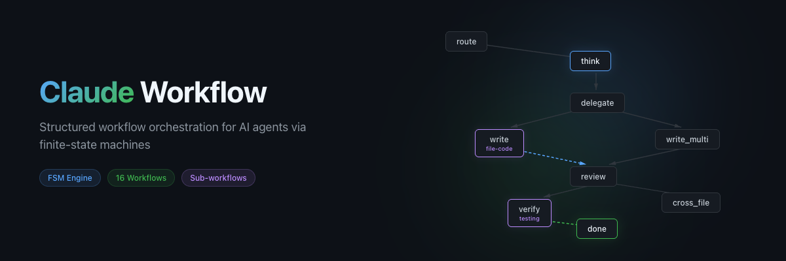
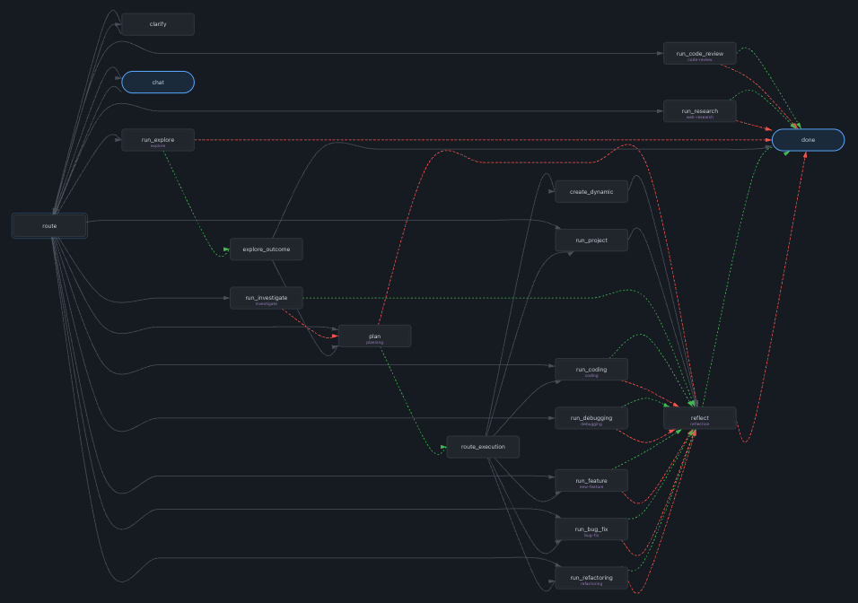
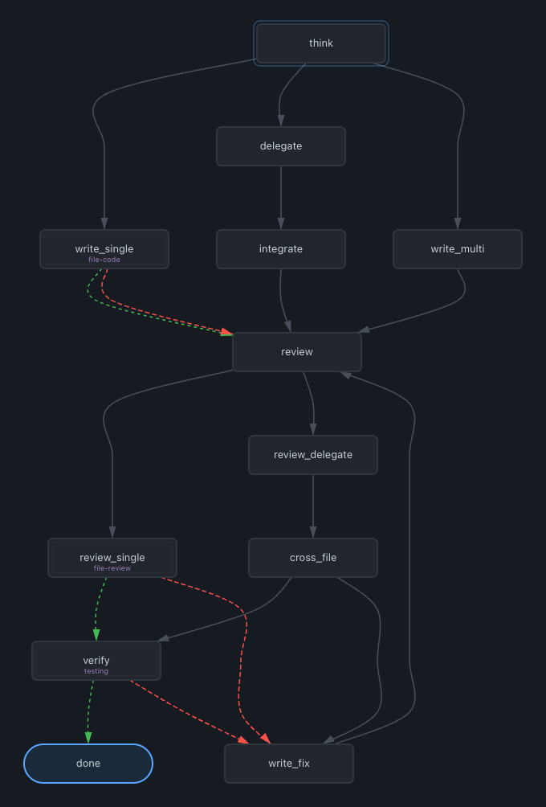
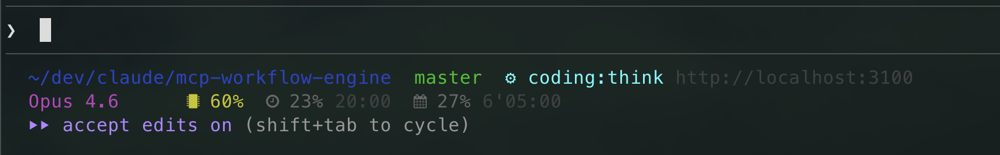

<p align="center">
  
</p>

<p align="center">
  <a href="https://www.npmjs.com/package/claude-mcp-workflow"></a>
  <a href="LICENSE"></a>
  <a href="https://www.typescriptlang.org/"></a>
  <a href="https://code.claude.com/docs/en/plugins"></a>
</p>

A Claude Code plugin that drives agents through YAML-defined state machines. The engine tracks state, enforces guards, manages nested sub-workflow stacks, and visualizes everything in a web dashboard.



## Features

- **FSM-based state machines** — define workflows in YAML with states, transitions, and prompts
- **Stack-based sub-workflows** — states can push nested workflows (max depth 10), auto-pop on completion
- **Three-tier loading** — bundled templates < global (`~/.claude/workflows/`) < project (`.claude/workflows/`)
- **Snapshot isolation** — workflow definitions frozen at session start; hot-reloads don't affect running sessions
- **Runtime overlays** — modify workflows on the fly without touching YAML files
- **Action states** — `exec` runs shell commands, `fetch` makes HTTP requests, with auto-routing by exit code or HTTP status
- **Web dashboard** — real-time session monitoring with DAG graph visualization
- **20 bundled workflows** — complete agent lifecycle from routing to reflection, including long-running batch orchestration and a text-only `docs` route
- **28 bundled skills** — reusable knowledge modules auto-provisioned on first run
- **SessionStart hook** — auto-provisions missing skills and injects workflow context
- **Pool gate** — a PreToolUse(Bash) hook runs the commands a project marks heavy (`.claude/workflows/pool-gate.json`) under `wf-run`, so agents' own test runs and builds share the machine-wide thread pool too
- **Survives a restart** — when Claude Code exits, its sessions are suspended, not abandoned; `claude --resume` continues them (`resume`), sub-agents included, and an exec that was running keeps running and is taken over

## Quick Start

### From Community Plugins (recommended)

The plugin is listed in the [claude-plugins-community](https://github.com/anthropics/claude-plugins-community/) catalog:

```bash
/plugin marketplace add https://github.com/anthropics/claude-plugins-community
/plugin install workflow
```

### From npm

Create a `marketplace.json` and add it as a source, or install directly:

```bash
# 1. Add a marketplace with this plugin
/plugin marketplace add <marketplace-with-workflow>

# 2. Install
/plugin install workflow@<marketplace-name>
```

See [Creating a marketplace](https://code.claude.com/docs/en/plugin-marketplaces) for how to set up an npm-based marketplace with this plugin:

```json
{
  "name": "workflow",
  "source": { "source": "npm", "package": "claude-mcp-workflow" }
}
```

### Manual (for development)

```bash
git clone https://github.com/AxGord/claude-workflow.git
cd claude-workflow
npm install
npm run build
claude --plugin-dir ./
```

### Install channels

Supported marketplace sources: the **npm package** (`claude-mcp-workflow`) and a **local directory**. A marketplace entry that points at the git repository (git URL as a plugin source) is **not** supported — `build/` is gitignored, so a git-sourced install has no compiled MCP server to run. (Cloning for development works — see above — because you run `npm run build` yourself.)

## Recommended CLAUDE.md Snippet

The engine only helps when the agent actually starts a workflow. Add this to your `~/.claude/CLAUDE.md`:

```markdown
- **ALWAYS** start every conversation by calling `mcp__plugin_workflow_wf__start()` (no arguments) before doing anything else, including answering the user
  - **EXCEPTION**: If you are a sub-agent spawned by the Task tool, do NOT call `start()` without arguments — the parent agent manages the workflow session. Follow the start instructions from the parent's preamble instead
```

## Recommended Permissions

Auto-allow the workflow tools so the agent is not interrupted with a permission prompt on every transition. In `~/.claude/settings.json`:

```json
{
  "permissions": {
    "allow": [
      "mcp__plugin_workflow_wf__list",
      "mcp__plugin_workflow_wf__start",
      "mcp__plugin_workflow_wf__status",
      "mcp__plugin_workflow_wf__transition",
      "mcp__plugin_workflow_wf__context_set",
      "mcp__plugin_workflow_wf__modify",
      "mcp__plugin_workflow_wf__create",
      "mcp__plugin_workflow_wf__delete",
      "mcp__plugin_workflow_wf__sessions"
    ]
  }
}
```

`abort` is deliberately **not** allowlisted: sub-agents inherit permissions, and an auto-allowed `abort` would let a sub-agent silently kill its parent's session. Keep it behind a manual prompt.

## How It Works

```
Agent                       Engine                          Storage
  │                           │                               │
  ├── start() ───────────────►├─ snapshot workflows ─────────►├ session.json
  │◄── initial state prompt ──┤                               │
  │                           │                               │
  ├── transition() ──────────►├─ validate & advance ─────────►├ update JSON
  │◄── new state prompt ──────┤  (push/pop sub-workflows)     │
  │                           │                               │
  ├── transition() ──────────►├─ terminal state? ────────────►├ mark complete
  │◄── done ──────────────────┤  (auto-pop to parent)         │
```

1. `start()` — creates a session, snapshots all workflow definitions, returns the initial state prompt
2. `transition()` — validates the transition, advances state, handles sub-workflow push/pop, returns the new prompt
3. Every mutation is atomically persisted to JSON (temp file + rename + lockfile)
4. Dashboard visualizes sessions and workflow graphs at `localhost:3100`

## Workflow YAML

```yaml
name: my-workflow
description: "Example workflow"
initial: start
max_transitions: 50

states:
  start:
    prompt: "Analyze the task and decide on approach"
    transitions:
      implement: write_code
      explore: research

  research:
    sub_workflow: explore        # pushes nested workflow
    on_complete: write_code      # returns here on success
    on_fail: start               # returns here on failure

  write_code:
    prompt: "Write the implementation"
    transitions:
      done: finish

  finish:
    terminal: true
    outcome: complete            # or "fail"
```

## Action States

### Restart: suspend and resume

When Claude Code exits (SessionEnd), its active sessions and their active descendants are **suspended**: stack, context and children stay, no ledger line is written. The SessionStart hook records which conversation each process runs (`$STATE_DIR/claude-session-<pid>`); the server stamps it on every session it starts, and SessionEnd stamps the ending one.

- **`claude --resume` / `--continue`** keep the conversation id, so the SessionStart hook (`source: "resume"`) PICKS UP that conversation's sessions by itself — the suspended ones and those a crash left to a dead process, with their sub-trees (a descendant another live process runs, or a session whose parent is active elsewhere, stays where it is): through `build/session-cli.js` it hands each to the new process under the session files' locks (`Storage.update`) and clears every suspension. Its output names each picked-up session (`picked up: <session> @ <workflow @ state>`) and, below it, the sub-agent sessions with the `SendMessage` that wakes each agent — only the main agent can send it; the agent continues its session with `status`, no `resume`. A session below it with no `agent_id` on itself or on any session up to the root (e.g. a pipeline the main agent runs itself) is taken for the main agent's: one line `<session> → <state> — no agent linked — yours, unless a sub-agent you spawned runs it (then link_agent + SendMessage) → status({ session_id })`. The action step a session stopped in is named apart: `exec in flight`, `exec finished while no server ran`, `exec killed by the restart` (no process, no exit code), `step interrupted before its exec started`. That step is finished by the first `status` / `transition` of the session (a `transition` then is not taken — it answers as an error with the state the session moved on to): a running exec is waited for, a finished one gives its recorded result, and one killed or never started runs again — the engine writes `pending_action` before an exec waits for its pool lease or spawns, so a server gone in between (e.g. waiting for a `resource:` lease) leaves the step to run again, lease wait included. A previous server still alive (Claude crashed, the server did not exit) that gets its lease after the session left it — suspended or owned by another process — gives the lease back without starting the exec (`ExecContext.mayStart`). Not covered: a `fanout:` whose shards already run in such a surviving server (the rerun runs beside them), and a restart of the MCP server inside the same Claude process with the old one still alive (the same pid — `mayStart` cannot tell them apart). `status` of a session sitting in an action state names it (`[exec state "<s>": running in this server | running in PID … | begun by a server that is gone … | not running …]`) instead of `[sub_workflow: unknown]`. Without a build or node the hook lists the suspended roots for an explicit `resume` instead. A fresh `startup` picks up and lists nothing.
- **`/compact`** (and `/clear`): the hook's output becomes part of the new context, so it prints this process's active sessions as a tree (id, workflow @ state, the stack when nested, agent, the action step it stopped in) — a compacted orchestrator knows where it is.
- **`resume({ session_id })`** — the explicit path (startup, another account, `--fork-session`) — hands the session and its sub-tree to the current process and returns the session's state. Its suspended sub-agent sessions are listed as agent → session → state, each with the `SendMessage` that wakes its agent; the agent continues ITS OWN session with `resume`, not a new `start`. A suspended child no agent drives (no `agent_id` up to the resumed session) is taken for the caller's: `no agent linked — yours, unless a sub-agent you spawned runs it (then link_agent + SendMessage) → resume({ session_id })`. `link_agent({ session_id, agent_id })` records which agent drives a child session (call it after the spawn, once the child's session id is known).
- **Another account** (the conversation cannot be resumed), or `--fork-session` (a new conversation id — the SessionStart hint lists nothing): `suspended()` lists the suspended sessions of this project (git root of the server's cwd; `all: true` for every project) — `resume` any of them.
- **An exec in flight**: every foreground exec runs detached in its own process group, its output in files and its exit code written to a file when it ends (`$STATE_DIR/exec/`), so it outlives the server; the session records it (`running_exec`) while it runs. `resume` of a session stopped in that exec state finishes it: still running → waits (abort kills it; its `timeout` counts from its start); finished → takes the recorded exit code and output; neither (the machine rebooted) → runs the step again. Its pool lease lives while its process group does. A `fanout:` state runs again. The run dir is owner-only (0700); server start removes run files older than a day that no session references. The output files are not capped while the command runs (`yes` writes until its `timeout`) — only the tail of `max_output` BYTES is read back.
- A crash that skipped SessionEnd: the next server start suspends the sessions of dead processes. A session suspended longer than `WF_SUSPENDED_TTL_DAYS` (default 7) is abandoned at server start, with its ledger line.
- `transition` / `context_set` / `modify` refuse a suspended session and name `resume`.

States can run shell commands or HTTP requests automatically — the agent doesn't participate, the engine handles execution and routes to the next state based on the result.

### `exec` — run a shell command

```yaml
run_tests:
  type: exec
  command: "npm test"
  cwd: "{{context.cwd}}"
  timeout: 30000
  on_success: analyze
  on_error: fix
  success_prompt: "Tests passed:\n{{stdout}}"
  error_prompt: "Tests failed (exit {{exit_code}}):\n{{stderr}}"
```

An exec without `cwd:` runs in the session's cwd (`start`'s `cwd`, else the server's); a relative `cwd:` resolves against it. Its env carries `WF_PLUGIN_ROOT`, `WF_SESSION_ID`, `WF_PARENT_SESSION_ID` (empty at the root), `WF_ROOT_SESSION_ID`, `WF_PRIORITY` / `WF_PRIORITY_LEVEL` (the session's priority, below), plus `WF_THREADS` under a `resource:` lease with threads (below). Every exec runs in its own process group: a timeout, `abort`, or a parent's abort cascade kills `sh -c` together with everything it started. A foreground exec writes its output to files, not pipes to the server, and resolves when its shell exits — a background child it left behind keeps running, but no longer holds the step open; a command killed by a signal exits 128+signal; on `timeout` the group gets SIGTERM, then SIGKILL after 5 s if anything in it is still alive, and the step resolves only once the group is gone (a lease is released with it). `max_output` counts bytes of the output's tail. The history entry records `exit_code` and `duration_ms`.

### Heavy work — the machine-wide thread pool

A `transition` / `start` / `resume` / `status` call that waits for an exec (pool lease queue included) sends an MCP progress notification every 60 s (`waiting for pool lease (Ns)` / `running <state> (Ns)`) when the client gave a `progressToken`, so Claude Code's no-response timeout does not cut the call.

Light commands run as plain execs and never wait. Heavy ones (test suites, release builds, corpus runs) take a lease from one pool shared by every session, project and Claude config dir on the machine — `$WF_POOL_DIR`, default `~/.claude/workflow-pool` (deliberately not under `CLAUDE_CONFIG_DIR`):

```yaml
run_suite:
  type: exec
  command: "npm test"
  resource: { threads: 6, priority: 0, wait_timeout: 900 }
  cases: { "0": analyze, "75": machine_busy }
  default: fix

test_wide:
  type: exec
  command: 'vitest run --maxWorkers="$WF_THREADS"'
  resource: { threads: { min: 2, max: budget }, wait_full: 60 }   # flexible: 2..budget threads
  on_success: done
  on_error: fix

dev_server_smoke:
  type: exec
  command: "npm run e2e"            # binds the fixed port 3000
  resource: { threads: 2, locks: ["port:3000"] }
  on_success: done
  on_error: fix
```

The same admission is a CLI for shell steps and agents' own commands (`bin` of the package; `scripts/wf-run` for execs: `"$WF_PLUGIN_ROOT/scripts/wf-run"`):

```bash
wf-run [--threads N|budget|MIN-MAX [--wait-full SEC]] [--lock NAME]… [--priority P] [--wait-timeout SEC] [--label TEXT] [--efficiency] [--fail-open] -- <cmd> [args…]
wf-run --status    # one line per lease and waiter
```

**The lease only counts threads — the command must actually use that many.** Compilers, test runners and optimizers take every core by default, whatever the lease says. The leased command gets `WF_THREADS` = the threads granted (after `budget` and the clamp to the budget); pass it on: `make -j"$WF_THREADS"`, `vitest --maxWorkers="$WF_THREADS"`, `HXCPP_COMPILE_THREADS="$WF_THREADS" haxe build.hxml`, `oxipng -t "$WF_THREADS"`, `APQ_ORACLE_PARALLEL="$WF_THREADS"`. It is set only for a lease with threads — never for a light exec, a lock-only lease or `--efficiency` (an inherited value is dropped). It is env only, not a template variable: write `$WF_THREADS` in the command.

- **Admission** (under a proper-lockfile lock on `<pool dir>/pool.json`): `held + N <= budget`, and beside a live lease also `held + N + external <= budget` — external load never blocks an EMPTY pool (a head with N ≥ budget would otherwise wait forever on background load). `external = max(0, load − held − load_threshold)` is the load not taken through the pool. `load` is measured from cpu ticks (`os.cpus()`): busy cpus over the window since the pool's previous pass (≥ 0.5 s; a window over 5 s is stale and restarts); without a window (first pass, stale) it falls back to `loadavg1`, which is conservative — it lags a minute and still holds load that has ended. `<pool dir>/config.json` (optional): `budget` (default: performance cores − 2 — `hw.perflevel0.physicalcpu` on macOS, else `os.cpus().length` − 2, at least 1) and `load_threshold` (default 2: the noise floor of light work).
- **Named locks**: `resource: { locks: [NAME, …] }` / `--lock NAME` (repeatable) — machine-wide mutual exclusion by name (one word, no whitespace: `port:3000`, `ios-simulator`; a name may template a session value — `"{{context.cwd}}-land"` — and whitespace it renders becomes `_`), for dev servers, bridges and anything else on a fixed port or a single device. `threads` is optional beside `locks` (a lock-only lease takes no threads and is never blocked by load; `wf-run --lock` without `--threads` is lock-only), at least one of the two is required. Locks and threads are granted ATOMICALLY in one pass: a task gets everything it asked for or keeps waiting holding nothing — no partial hold, so no deadlock between two tasks wanting the same pair. A dead holder is reaped like any lease; `abort` withdraws a lock wait; `--status` lists held locks; `wait_timeout` → 75.
- **Order**: strictly priority descending, then arrival — nothing overtakes a waiter on what it waits for. A smaller task never overtakes the head waiting for threads; a lock goes to its waiters in queue order. A waiter blocked by a held lock claims no threads, so a long-held lock (a dev server) does not stall the rest of the queue. `N` above the budget counts as the budget: it waits for an empty machine and runs alone. `threads: budget` / `--threads budget` asks for the whole budget as `config.json` sets it when the request is made — no hardcoded core count in a workflow.
- **Priority levels**: a session has a level — `low` (−100), `normal` (0, the default), `high` (100), `urgent` (200) — set by `start({ priority })` and inherited by its child sessions (an explicit `priority` on a child's `start` overrides it for that subtree). A lease's priority = the session level + the step's own `resource.priority`, so a step fine-tunes within its level (keep it under ±100). `set_priority({ session_id, level })` changes the level of a session and of its active descendants at once (later children inherit it) and re-ranks their WAITING pool entries in the same pass; running leases keep theirs — there is no preemption. Every exec gets `WF_PRIORITY` (that sum) and `WF_PRIORITY_LEVEL`; `wf-run` without `--priority` queues at `WF_PRIORITY` and keeps the level, so a nested `wf-run` is re-ranked with its session. Two windows keep the old level: an exec whose context was built just before `set_priority` but had not yet joined the queue waits at the old level until it is granted, and a `wf-run` inside an exec started before `set_priority` takes that exec's old `WF_PRIORITY`. An explicit `--priority P` is the whole priority and has no level. `set_priority` is for the user's request — an agent never raises its own session or changes another project's.
- **Flexible threads**: `threads: { min: A, max: B|budget }` with `wait_full: SEC` (default 0), or `wf-run --threads A-B [--wait-full SEC]` (`B` may be `budget`). The waiter gets `B` when `B` fits; otherwise, once `wait_full` seconds have passed since it queued, it takes every thread that fits if that is at least `A`. `WF_THREADS` = the threads granted. Order is unchanged: while a flexible head waits — for `B` inside its window, or for `A` after it — it closes the threads to everyone behind it like any waiter (the window waits for threads being freed; a smaller task taking them would defeat it). `A`/`B` above the budget clamp to it. `wait_full` without a `{ min, max }` is a load error, `--wait-full` without a range a usage error. `threads: N` is `{ min: N, max: N }`.
- **Status**: `wf-run --status` and the `pool_status` MCP tool print the budget, the load and one line per lease and per waiter (in admission order): `pid`, what it holds or wants (`holds 6 threads (asked 2-8) + lock sim` / `wants 2-8 threads`), `prio` with the level, `since HH:MM:SS (Ns)`, the project (the git root of its cwd, a linked worktree mapped to its main repo, `~`-shortened), `session`, `step` (`workflow/state`) and the label (the command).
- **Reaping**: leases and waiters whose pid is dead are dropped on every pass; a `wf-run` lease records its child's process group and lives while `wf-run` OR that group does (a SIGKILLed `wf-run` leaves its child running — inside the budget). A waiter polls each second and wakes at once when `pool.json` changes; `wf-run` prints a progress line to stderr when it starts waiting and every 30 s.
- **Busy**: no lease within `--wait-timeout` / `wait_timeout` → exit **75** (EX_TEMPFAIL). An exec routes it through `cases`/`on_error`; its `timeout` counts the run only, and `wait_ms` is recorded beside `duration_ms` in the history and the ledger, together with `threads_granted` and `step_key` (below). `abort` withdraws a waiting exec. `resource:` is for foreground execs only (a load error on `background: true` or a fetch).
- **`wf-run`**: the child runs in its own process group with inherited stdio; `--status` measures over a 0.6 s tick window; SIGINT/SIGTERM/SIGHUP are forwarded to the group; the exit code is the child's; the lease is released on exit. `--efficiency` (macOS) runs the command under `taskpolicy -b` (efficiency cores, low priority) outside the budget — its `--lock`s still hold; elsewhere it warns and goes through the pool. `--fail-open`: when the pool itself cannot be used (dir not writable or not creatable, broken `config.json`, lock not taken) the command runs without a lease, `WF_THREADS` = the smallest share asked, plus one stderr line — busy still waits; without it such a failure is exit 1 and the command never starts.

#### Pool gate — agents' heavy Bash commands through the pool

Agents do not call `wf-run` themselves. The plugin's PreToolUse(Bash) hook (`hooks/pool-gate.sh` → `build/pool-gate-hook.js`) rewrites a command the project marks heavy into `<plugin>/scripts/wf-run --fail-open --threads <N|MIN-MAX> --label '<command>' -- <shell> -c '<command>'` (absolute path, not `PATH`; `<shell>` = the Bash tool's `$SHELL` when it is sh/bash/zsh/dash/ksh, else `sh`). What is heavy is decided ONLY by the project's `.claude/workflows/pool-gate.json`, the nearest one from the command's cwd up to the git root (none outside a git repo). No config, or no rule hit → the command is untouched and the hook says nothing; the no-config case is decided in the shell script itself (no node started), so a project without a `pool-gate.json` pays a few milliseconds per Bash call. Example (a sample — the plugin creates no project config):

```json
{
  "rules": [
    { "match": "npx vitest run", "threads": "2-8", "pass": "--maxWorkers=$WF_THREADS" },
    { "match": "npx vitest", "deny": "watch mode never ends under the pool — use `npx vitest run`" },
    { "match": "/^turbo run (build|test)\\b/", "threads": 6, "pass": "--concurrency=$WF_THREADS" },
    { "match": "haxe", "threads": 4, "pass": "env:HXCPP_COMPILE_THREADS" },
    { "match": "make", "threads": "2-6", "pass": "-j $WF_THREADS" }
  ],
  "wrappers": ["golf-run.sh", "tm-run.sh"]
}
```

- **`match`**: the leading words of a simple command (the first word also by basename: `haxe` hits `/opt/bin/haxe`; leading `VAR=x`, `env`, `time`, `exec`, `!` and `if`/`then`/`do` … are skipped), or `/regex/flags` tested on the command's text. The first rule that hits a segment wins, so put `npx vitest run` before the `npx vitest` refusal.
- **`env`** (optional): conditions on the segment's leading assignments (`NAME=value` before the command, also after `env` / `time` …), all of which must hold for the rule to hit — `true` = set (any value, empty too), `false` = not set, `"/regex/flags"` = set and its unquoted value matches. `match` alone cannot tell `APQ_TEST=unit. node bin/test.js` from a bare `node bin/test.js` (it sees the text from the command word on); `{ "match": "node bin/test.js", "env": { "APQ_TEST": true }, "threads": 1 }` before `{ "match": "node bin/test.js", "threads": 8 }` can. Only the segment's own assignments count — not `export` in an earlier segment, not the hook's environment.
- **`threads`**: `N` or `"MIN-MAX"` (a flexible lease, `WF_THREADS` = what was granted). **`pass`** (optional) tells the command its share: a flag holding `$WF_THREADS`, put after the matched words (a regex hit: at the end, or before a `--` word when there is one) unless the command already gives that flag (`-j 2`, `-j8`, `--concurrency=2` stay), or `env:NAME` → `env NAME="$WF_THREADS"` in front of the command. `$WF_THREADS` is expanded by the shell under `wf-run`.
- **`deny`**: instead of `threads` — for what does not belong in a queue (watch modes, dev servers); the call is refused with the reason (`permissionDecision: deny`). Order: a segment that runs `wf-run` or a `wrappers` script is never matched against the rules, `deny` included — its command already runs under a lease, by an explicit choice (the gate's own wrapped form too, so a `/regex/` needs no `^` anchor to keep off it); every other segment of the same command is still matched, and a `deny` hit there refuses the whole call.
- **`wrappers`**: project scripts that take their own lease (they call `wf-run` inside); a command running one is never wrapped again. A wrapper that takes no lease is not listed — a rule matching its name wraps the whole call, the script stays unchanged.
- **Splitting**: quotes, escapes, `$( )` and backticks are honoured; segments split at `&&` `||` `;` `|` `(` `)` and newlines. A hit anywhere wraps the WHOLE command under ONE `wf-run` with the largest share any hit asks (mins and maxes each take their largest) — simpler and safer than cutting a shell line apart (redirections, pipes, `cd` all keep working; segments run one after another, so the largest is enough; a pipe of two heavy commands is under-counted). A heavy command inside `$( )` is not seen.
- **Left alone**: `WF_THREADS` already in the hook's environment (Claude Code itself runs under a lease), a command holding `wf-run` or a `wrappers` script anywhere (a nested lease could wait on its own outer one), a background `&` (the lease would end before the work), a heredoc or an unterminated quote (not plain enough to edit).
- **Bypass**: `WF_POOL_BYPASS=1 [WF_POOL_BYPASS_REASON='…'] <command>` — untouched, one stderr line naming the reason.
- **Output**: unchanged — `wf-run` writes only to stderr (waits, progress) and exits with the command's code; the gate passes no `--wait-timeout`, so a busy pool means a wait, never exit 75. A Bash call that reaches its own timeout while waiting is moved to the background like any long command, not killed.
- **Never breaks Bash**: no node, no build, a broken `pool-gate.json` or any error in the gate → the command passes as it is plus one stderr line. `--fail-open` does the same for the pool: a pool `wf-run` cannot use (an unwritable or uncreatable `$WF_POOL_DIR` — a sandbox, a read-only `~/.claude` —, a broken `config.json`, a lock it cannot take) runs the command without a lease, `WF_THREADS` = the smallest share asked, plus one stderr line. Busy is not a failure: it waits.
- **With RTK**: Claude Code (2.1.312) keeps the LAST `updatedInput` of parallel PreToolUse hooks, which is almost always this gate's — RTK's own rewrite of the same command would be lost. So when `rtk` is on `PATH` the gate puts the body through `rtk rewrite` itself, from the command's cwd: exit 0 → RTK's rewrite and `permissionDecision: "allow"` (RTK checked that the user's allow rules cover every command in the chain — the decision Claude Code would take on the original line, whereas its own check sees the rewritten one); 3 → RTK's rewrite, no decision; 2 (a deny matched) → the gate leaves the whole command alone, so Claude Code's deny sees the original line; anything else → the body as it is. Without `rtk` there is no decision: the usual permission flow checks the rewritten line.
- **Never add an allow rule for `…/scripts/wf-run`**: `Bash(<plugin>/scripts/wf-run:*)` would allow ANY chain wrapped behind it, and the path changes with every plugin version anyway.
- **Limits**: the inner `<shell> -c` does not get the Bash tool's shell snapshot (aliases, functions, `setopt`); `npx -y …`, `sudo …`, `nice …` and commands inside `$( )` are not recognised; the config is found from the call's `cwd`, not from a `cd` inside the command, and a `cd` inside a wrapped command does not move the Bash tool's working directory.

### `fetch` — make an HTTP request

```yaml
check_api:
  type: fetch
  url: "http://localhost:8888/ping"
  method: GET
  timeout: 5000
  retry:
    max: 60
    interval: 500
  on_success: ready
  on_error: wait
  success_prompt: "API ready: {{body}}"
  error_prompt: "Not responding: {{error}}"
```

### Routing

Action states route via `on_success`/`on_error`, or by specific codes using `cases`:

```yaml
run_tests:
  type: exec
  command: "npm test"
  cases:
    "0": all_passed
    "1": tests_failed
    "2": no_tests_found
  default: unknown_error
```

An exec killed by its `timeout` exits 124. `on_timeout: <state>` routes that apart from every other
outcome (it wins over `on_error` and `cases`) — a gate that timed out on a loaded machine is not a
code defect and should not enter the fix loop. Foreground exec only; beside `cases: { "124": … }` it
is a load error (two routes for one outcome).

### Fan-out — one command, many shards

```yaml
suite:
  type: exec
  command: "npx vitest run --shard=$WF_SHARD"
  timeout: 600000                      # per shard
  fanout: { count: 4, threads_each: 3, max_parallel: 4 }
  on_success: green
  on_error: red
  on_timeout: slow_machine
```

The engine runs the command `count` times with `WF_SHARD=i/N` (1-based, `vitest`/`jest` `--shard`
form), or once per non-empty line `items_command` prints with `WF_ITEM=<line>`
(`fanout: { items_command: "ls test/suites", threads_each: 2 }`). Each instance takes its own lease of
`threads_each` threads from the pool (`WF_THREADS`), so shards start as threads free up and the
machine-wide budget holds; `max_parallel` caps the instances in flight (default: as many as the
budget runs side by side, `budget / threads_each` — the rest wait outside the pool queue, so other
sessions are not stuck behind the whole fan-out). Lines of `items_command` lose a trailing `\r`. `timeout` bounds
each shard. The step exits 0 only if every shard does; otherwise with the failing shards' common exit
code (all of them timed out → 124, which `on_timeout` routes), or 1 when they differ. `{{stdout}}` is
the summary — `fanout: 3/4 ok, 1 failed (exit 1)` and each failed shard's output tail. Abort kills
the running shards, withdraws the waiting ones and starts no more. History and ledger keep one
`shards` entry per instance (`shard`, `exit_code`, `duration_ms`, `wait_ms`, `threads_granted`).
`fanout` is a load error beside `background` or `resource`; a failing `items_command` fails the
step without running a shard.
Known limitation: a fan-out's leases take no `resource:` options — no `wait_timeout` (so no exit 75
route), no `locks`, no step `priority` (the session level only).

### Template variables

All prompts support `{{mustache}}` templates. Context values are available everywhere via `{{context.key}}`, as are `{{visits.<state>}}` (visit count in the active stack frame; empty if never visited), `{{root_workflow}}` (the workflow at the stack root, e.g. `subagent`), `{{session_id}}` and `{{parent_session_id}}` (empty at the root). After action execution, result variables are also available:

| Source | Variables |
|--------|-----------|
| `exec` | `{{stdout}}`, `{{stderr}}`, `{{exit_code}}`, `{{pid}}` (background), `{{wait_ms}}` (`resource:`) |
| `fetch` | `{{status}}`, `{{body}}`, `{{error}}` |

They come from the session's last action result (`last_action_result` in the session JSON), so they are not limited to the action's own `success_prompt` / `error_prompt` / `context_set`: the state an action routes into renders them in its own `prompt`, later prompt states still see them, and the next action state reads them in its `command` / `env` — until that action replaces them. `context_set` a value to keep it past the next action.

Action states can be chained — `exec` → `exec` → `fetch` → `prompt` — up to 20 steps without agent involvement.

### Guards and the exhausted route

`max_transitions` (per workflow, per stack frame, default 50) and a state's `max_visits` refuse a move past them with an error. A state may instead name where a move past its `max_visits` goes:

```yaml
fix:
  prompt: "Fix attempt {{visits.fix}}"
  max_visits: 3
  on_exhausted: escalate      # the 4th move into fix enters escalate instead
  transitions: { retry: verify }
```

The route applies to every move into the state — an agent `transition`, an action state's `on_success`/`on_error`/`cases`, a skill gate's auto-transition; a pop's `on_complete`/`on_fail` does not check `max_visits`. Chained routes are followed (an exhausted `escalate` with its own route goes on), a cycle is an error, and the history entry's `detail` names the exhausted states. A rerouted action move shows the routed-to state's own prompt, not the action's `success_prompt`/`error_prompt` (written for the default target); the result stays readable there as `{{stdout}}`/`{{exit_code}}`. `on_exhausted` without `max_visits`, or to an unknown state, fails the load. `{{visits.<state>}}` counts visits in the active frame, so the routed-to state can say how many tries ran.

### Strict schema

An unknown key in a workflow, a state, a `retry:`, `resource:` or `fanout:` block fails that workflow's load (stderr names the file, the state, the key and the nearest known key) — a typo is never silently ignored.

### Ledger

Every session end (complete, fail, abort, cascade, expiry of a suspended session) appends one JSON line to `$STATE_DIR/ledger.jsonl`: ids (session / parent / root), workflow, outcome (`completed` / `failed` / `abandoned`), start/end time, transition count, the exec durations by state and their pool waits (`wait_ms`, `wait_ms_total`). A `resource:` exec also records `threads_granted` (absent when it got no lease), a `fanout:` exec its `shards`, and both `step_key` = `<project>|<workflow>|<state>` (project = the git root of the session cwd, every worktree of a repo mapping to its main one) — the raw data a model of step time against threads keys its runs by; the engine only records it. Appends follow the session files' lock discipline with the ledger's own lock file; the ledger is never pruned with old sessions.

## Three-Tier Loading

Workflows load from three sources in ascending priority — later tiers override earlier ones:

| Tier | Path | Purpose |
|------|------|---------|
| Bundled | `templates/` (plugin root) | Base workflows shipped with the plugin |
| Global | `~/.claude/workflows/` | User customizations shared across projects |
| Project | `.claude/workflows/` | Project-specific workflows |

A project workflow named `coding` overrides the bundled `coding` template. Same-name global workflows sit in between.

The project tier is the server's cwd. A session started with `start({ cwd })` in ANOTHER project that has
its own `.claude/workflows/` (a worktree counts as its main checkout; the home dir, whose
`.claude/workflows` is the global tier, is none) sees the workflows that project defines itself laid by
name over the server's — a name only the server has is still found: a dispatcher in one repo can run a task by the
procedure another repo defines (a queue line's `repo:` + `workflow:`).

### `extends:` — inherit a workflow

```yaml
# .claude/workflows/testing.yaml
name: testing
extends: testing          # the global / bundled testing, never this file
states:
  project_test:           # replaces the base state of that name WHOLE
    type: exec
    command: "npm test -- --maxWorkers=$WF_THREADS"
    timeout: 600000
    resource: { threads: 6 }
    on_success: check_integration
    on_error: fix_unit
    on_timeout: suite_slow
  suite_slow:             # a new state joins the base's
    prompt: "The suite timed out — machine loaded? Re-run (`retry`) or report."
    transitions: { retry: project_test }
```

The definition is the base's, with the heir's states laid over it by name (a same-named state is
replaced whole, not merged key by key; new states are added). `initial`, `max_transitions` and
`description` come from the heir where it sets them. A heir extending its OWN name inherits that
name from the tiers below its file (project `coding` → global, else bundled `coding`); another name
resolves like any workflow name (the top tier). Chains work; a cycle, a missing base, or `extends`
of its own name with nothing below fail the load. Reference checks (initial, transitions, routes)
run on the merged result. Without `extends`, `initial` and `states` are required.

**Extension points.** The bundled workflows expose the steps a project usually wants to own as
states with contract names; bundled, each keeps the old behaviour (the agent does it, or nothing):

| State | In | Bundled default | Routes a heir's exec should keep |
|---|---|---|---|
| `project_test` | `testing` | prompt: the agent runs the tests via a runner subagent | `on_success: check_integration`, `on_error: fix_unit` |
| `project_build` | `testing` | prompt: build before integration | `on_success: integration`, `on_error: fix_integration` |
| `project_gate` | `testing` | exec `true` — no gate | `on_success: done`, `on_error: failed` (the caller's fix round) |
| `project_build` | `bug-fix` | prompt: build the fixed app before the visual check | `on_success: verify_visual`, `on_error: write_fix` |
| `project_prepare` | `batch-task` | exec: `git worktree add <repo>/../.wt/<repo-name>/<ID> -b batch/<ID>`; stdout = the path alone | `on_success: work`, `on_error: prepare_failed` |
| `project_land` | `batch-task` | exec under the lock `{{context.cwd}}-land`: `git merge --no-ff` + the queue's `land_test:` (red → the merge is taken back with `reset --keep`; unsafe → exit 4, nothing touched) | `cases: {"0": mark_done}`, `default: land_failed`, `on_timeout: land_failed` |

`coding` and `bug-fix` verify through `testing`, so one heir of `testing` serves both. Give every
heavy step `on_timeout:` and a state of its own for it.

### Task queue — `batch`, `queue_next`, `wf-queue`

A long run of tasks is a queue FILE the engine admits from — one format for every project:

```markdown
# Batch: wave-3
batch_size: 3                       # the window; `batch_size: 0  # pause: <why>, was 3` pauses
base: /abs/repo=<sha>
land_test: npm test                 # run after each merge (batch-task's default land)
## Tasks
- [ ] T1 | model: opus | effort: high | touches: src/engine | <self-contained brief> |
- [ ] T2 | model: sonnet | after: T1 | touches: src/a, docs | owner: typer | repo: other-repo | <brief> |
```

Keep the queue file untracked and ignored (e.g. `.claude/batch/` in `.gitignore`): a tracked queue is
dirtied by the first pick, and `batch-task`'s land refuses a dirty tree (exit 3). The land takes a
merge back with `git reset --keep` only while HEAD is still that merge; otherwise (HEAD moved during
`land_test`, or local edits on the merged files) it exits 4 and touches nothing.

Marks: `[ ]` pending, `[>]` running, `[x]` done, `[!]` failed. A pick fills the window (`batch_size`
minus the `[>]` lines) in file order with the `[ ]` lines that:

- are not parent-run (`model: —`) and carry no `⏸` in a metadata field or in `after:` (inside long
  prose it is a mention);
- have every `after:` id `[x]` (an id-like token that names no line, or prose beside the ids, is a
  condition for a human: never admitted);
- overlap no running and no just-admitted line: `touches:` paths overlap when one is a prefix of the
  other on a `/` boundary, `owner:` names when equal or one is a `.`-prefix; a line WITHOUT
  `touches:` overlaps everything (it runs alone);
- name a `repo:` that resolves (absolute path; a name = the `base:` repo of that basename, else the
  directory of that name beside the queue's project; none = the queue's project);
- name, in `workflow:` if any, one word: the line's own task workflow (default: the dispatcher's
  `task_workflow`). It is started with the line's repo as `cwd`, so it may live in that repo's
  `.claude/workflows/` — one queue can mix tasks of several repos, each run by its repo's procedure.

Each admitted line is marked `[>]` under the queue's lock (`<file>.lock`, an atomic mkdir), so two
picks — two tools, two processes — never admit one line. `batch_size: 0` is the pause: nothing new is
admitted, running tasks finish; the pick answers `window 0 — paused: <the comment>`.

- `queue_next({ file, dry_run?, explain? })` — the admitted lines (id, model, effort, repo, workflow, text);
  `explain` adds why each other pending line waits (`window full` lines fold into one summary line;
  `explain: "all"` lists every line).
- `queue_mark({ file, id, to, note? })` — `running` `[ ]`→`[>]`, `done` `[>]`→`[x]`, `failed`
  `[>]`→`[!]`, `released` `[>]`→`[ ]`; any other current mark is refused; `note` is written after the id
  (one line without `|`, `⏸` or a leading `key:`). A write lands only while the file still reads as
  the pick read it — a hand edit in between makes it plan again, never lost.
- From an exec: `"$WF_PLUGIN_ROOT/scripts/wf-queue" <file> [--dry-run] [--explain|--explain-all]` (also the `wf-queue`
  bin) prints `ID<TAB>model<TAB>effort<TAB>repo<TAB>workflow` (`-` = no `workflow:`) per admitted line and the summary on stderr; exit 0
  admitted, 10 none but `[>]` lines run, 11 none and nothing runs (done), 12 none, nothing runs and
  `batch_size: 0`, 2 error; `--done|--failed|--release|--running <ID> [--note T]`, `--header <key>`.

The bundled `batch` drives a queue: `plan_queue` (write or resume it; context `queue_file`,
`task_workflow`) → `pick` (exec, routes on the exit code: `dispatch` / `collect` / `cross_check` /
`paused`) → `dispatch` starts one child session per admitted line in its repo → `collect` advances them
on agent notifications and re-picks on every freed slot → one `cross_check` of the combined diff. The
child is `batch-task`: `claim` → `project_prepare` (worktree) → `work` (one worker agent, its session
linked) → `project_land` (merge + `land_test` under the repo's land lock) → `mark_done` → `cleanup`.
A project with its own procedure is a heir: `extends: batch` with `plan_queue` as an exec that sets
`queue_file` and `task_workflow` (`context_set:`), and a task workflow of its own or `extends:
batch-task` overriding `project_prepare` / `project_land`.

### When a project should have its own workflow

The bundled workflows fit simple projects and one-off tasks: the agent itself runs whatever build and
tests the project has. A complex project should drive its development through its own workflow in
`.claude/workflows/`. Signs that a project is complex:

- builds, test suites, linters or simulations that take minutes or saturate the CPU;
- a gate a change must pass before it merges (several checks, one verdict);
- several agents working at once, or one long queue of tasks;
- its own merge or release procedure.

Why it pays:

- **Deterministic steps become `exec` states.** Build, tests, gate and merge run inside the engine; the
  agent transitions and gets back only the verdict (keep it short — a table, the first error — and
  write full logs to files). No tokens spent re-reading build output, and no "forgot to run the tests".
- **Heavy steps go through the machine-wide pool** (`resource:`, `fanout:` for shards): sessions of
  every project share one CPU budget instead of racing each other, and a waiting exec costs the agent
  nothing — it sleeps inside the `transition` call until its lease is granted.
- **Short prompts.** A state's prompt says what to do NOW and links the project's docs instead of
  restating them; a worker's brief from the parent shrinks to a few lines.
- **Loops are explicit.** A fix-and-recheck cycle is `max_visits` + `on_exhausted`, not a rule the
  agent must remember; a timeout is `on_timeout`, not a fix round.

How: start with `extends:` — a heir of the bundled workflow under its own name that overrides only
the extension points (`project_test`, `project_build`, `project_gate`) with `exec` states
(`resource:` / `fanout:` where heavy, `on_timeout:` everywhere), so the base process keeps improving
underneath it. Add or replace further states only where the project's process really differs, and
keep judgement (design, code, review) in prompt states. Copy a whole workflow only when the process
itself is different.

## Bundled Workflows

| Workflow | Description |
|----------|-------------|
| `master` | Single entry point — analyzes task, loads skills, routes to sub-workflows |
| `coding` | Code writing pipeline: think → delegate → write → review → verify |
| `docs` | Text-only edits (skills, prompts, CLAUDE.md, memory, reports): write → verify — no lint, tests, or reviewer agent |
| `bug-fix` | Standard bug fix: classify → diagnose → fix → verify |
| `new-feature` | New feature implementation with planning and testing |
| `debugging` | Diagnose first, fix never (until diagnosed) |
| `code-review` | Code review with per-file deep analysis |
| `explore` | Codebase exploration — understand structure, trace code, find patterns |
| `investigate` | Resolve unknowns before deciding on action |
| `planning` | Explore, design plan, record workflow context |
| `testing` | Testing verification — unit tests first, then integration |
| `web-research` | Check existing knowledge, then delegate to web subagents |
| `reflection` | Self-reflection after significant tasks — evaluate, classify, act |
| `subagent` | Lightweight routing for sub-agents (no chat/plan/reflect) |
| `file-code` | Per-file coding — spawned by coding/bug-fix for each file |
| `file-review` | Per-file deep review — spawned by code-review for each file |
| `lint-review` | Trivial-diff review — engine-run lint, act on findings, one intent re-read |
| `batch` | Long-running task queue: the engine admits lines into the window (`after:` / `touches:` / `owner:` / pause), one `batch-task` child per task, one fresh-eyes review of the combined diff |
| `batch-task` | One queued task: worktree → worker → merge + `land_test` under the repo's land lock → mark done → cleanup |
| `review-push` | Review uncommitted changes, then commit and push to GitHub |
| `github-init` | Initialize git repo and create private GitHub repository |



## Bundled Skills

Skills are reusable knowledge modules loaded by workflows via `Skill()`. Auto-provisioned to `~/.claude/skills/` on first run if missing. Edit your local copy to override the bundled version — the hook never overwrites existing files.

**Methodology**

| Skill | Description |
|-------|-------------|
| `preferences` | Template for personal coding preferences (fill in your own) |
| `architecture` | Simplicity-first architecture decisions |
| `task-delegation` | When and how to delegate to subagents |
| `debugging` | Debugging meta-patterns — what to do when fixes don't stick |
| `coding-skill-selector` | Select and load coding skills by file extensions and domains |
| `workflow-authoring` | Reference for creating workflows with exec/fetch action states |

**Languages**

| Skill | Description |
|-------|-------------|
| `lang-haxe` | Haxe language gotchas (incl. macros, null safety, hxcpp) |
| `lang-python` | Python language gotchas |
| `lang-as3` | AS3 / AIR 51 language gotchas |

**Domains**

| Skill | Description |
|-------|-------------|
| `domain-yolo` | YOLO object detection model selection |
| `domain-pixi` | Pixi.js v8 masking and graphics gotchas |
| `domain-reid` | Person re-identification ML gotchas |
| `domain-gamedev` | Game dev precision and physics gotchas |
| `domain-pony` | Pony (Haxe cross-library) gotchas |
| `domain-ui` | UI component architecture — ownership, state, events |

**Platforms & Tooling**

| Skill | Description |
|-------|-------------|
| `target-openfl-native` | OpenFL/hxcpp native target gotchas |
| `build-cmake` | CMake build system gotchas |
| `ci-github-actions` | GitHub Actions workflow gotchas |
| `aws-lambda` | AWS Lambda .NET deployment gotchas |
| `mcp-setup` | MCP server setup and troubleshooting |
| `claude-code-config` | Claude Code configuration gotchas |
| `hxq` | When and how to use hxq for structural Haxe navigation |
| `browser-verify` | Browser-automation verification gotchas — stale captures, caches, headless limits |
| `debug-bridge-scaffold` | Meta-skill for creating debug bridges for new technologies |
| `ide-zed` | Zed IDE integration rules |

**Utility**

| Skill | Description |
|-------|-------------|
| `web-reading` | Fetch web content via subagents |
| `skill-manager` | Create, install, update, optimize skills |
| `cleanup` | Clean .claude directory data |

## MCP Tools

All tools are registered under the `wf` server. Full tool prefix: `mcp__plugin_workflow_wf__`.

| Tool | Description | Key Parameters |
|------|-------------|----------------|
| `list` | List all available workflow definitions | — |
| `start` | Start a workflow, return initial prompt | `workflow`, `actor`, `parent_session_id`, `cwd` (absolute existing dir — a sub-agent's worktree), `priority` (`low`/`normal`/`high`/`urgent`; default: the parent's level, else `normal`) |
| `status` | Get current state, stack, transitions, context (values cut to 200 chars), history — of any session, incl. a finished child; with `key`, only that context value, whole | `session_id`, `key` |
| `transition` | Advance to next state (auto push/pop sub-workflows) | `session_id`, `transition` |
| `context_set` | Save key-value data in session context | `session_id`, `key`, `value` |
| `modify` | Runtime overlay — add/change/remove states and transitions | `session_id`, `add_state`, `add_transition` |
| `create` | Create new workflow definition (saves YAML) | `name`, `definition`, `scope` |
| `delete` | Delete a workflow definition | `name`, `scope` |
| `abort` | Abort workflow, pop all stack frames | `session_id` |
| `sessions` | List all sessions (active first) | — |
| `set_priority` | Set the priority level of a session and its descendants; re-rank their waiting pool entries (no preemption) | `session_id`, `level` |
| `pool_status` | The machine-wide pool: one line per lease and waiter (as `wf-run --status`) | — |
| `resume` | Continue a suspended session in this process (and own its sub-tree); finishes an exec state it stopped in; lists the sub-agents to wake | `session_id` |
| `suspended` | Suspended sessions of this project (or `all`) | `all` |
| `link_agent` | Record the Agent-tool id of the sub-agent driving a child session (named by the parent's `resume`) | `session_id`, `agent_id` |
| `queue_next` | Admit the next lines of a task queue file and mark them `[>]` (§ Task queue) | `file`, `dry_run`, `explain` |
| `queue_mark` | Move one queue line's mark (`running` / `done` / `failed` / `released`) | `file`, `id`, `to`, `note` |

## Dashboard

The web dashboard runs on `localhost:3100` and provides real-time monitoring:

- **Sessions panel** — active sessions plus the most recent finished ones (terminal history is capped)
- **Workflow list** — all loaded workflows with state counts
- **Session detail** — state history, stack depth, context data
- **Workflow graphs** — interactive DAG visualization rendered with dagre

### REST API

| Method | Endpoint | Description |
|--------|----------|-------------|
| `GET` | `/api/sessions` | List all sessions |
| `GET` | `/api/session/:id` | Get session detail |
| `POST` | `/api/session/:id/abandon` | Abandon a session |
| `GET` | `/api/workflows` | List all workflow definitions |

## Configuration

| Variable | Default | Purpose |
|----------|---------|---------|
| `WORKFLOW_DIR` | `~/.claude/workflows/` | Global workflow YAML directory |
| `STATE_DIR` | `~/.claude/workflow-state/` | Session JSON persistence (also `exec/`: foreground exec output and exit codes) |
| `WF_SUSPENDED_TTL_DAYS` | `7` | A suspended session nobody resumed for this long is abandoned at server start |
| `DASHBOARD_PORT` | `3100` | Web dashboard HTTP port |
| `DASHBOARD_HOST` | `127.0.0.1` | Web dashboard bind address |

## Status Line

Show the active workflow and state in Claude Code's status bar:



Add this snippet to your statusline script:

```sh
# Workflow status — add to your ~/.claude/statusline-command.sh
wf_state_dir="$HOME/.claude/workflow-state"
if [ -d "$wf_state_dir" ]; then
  for f in "$wf_state_dir"/*.json; do
    [ -f "$f" ] || continue
    slen=$(jq -r '.stack | length' "$f" 2>/dev/null)
    if [ "$slen" -gt 0 ]; then
      cpid=$(jq -r '.context.claude_code_pid // 0' "$f" 2>/dev/null)
      [ "$cpid" != "$PPID" ] && continue
      wf=$(jq -r '.stack[.active_frame].workflow // ""' "$f" 2>/dev/null)
      st=$(jq -r '.stack[.active_frame].current_state // ""' "$f" 2>/dev/null)
      printf "\033[96m\xE2\x9A\x99 %s:%s\033[0m" "$wf" "$st"
      break
    fi
  done
fi
```

Then in `~/.claude/settings.json`:

```json
{
  "statusLine": {
    "type": "command",
    "command": "bash ~/.claude/statusline-command.sh"
  }
}
```

## Development

```bash
npm run build    # tsc → compiles src/ to build/
npm run dev      # tsc --watch
npm start        # node build/index.js
npm test         # vitest run
npm run check    # tsc --noEmit + format:check + lint + scan + vitest + check:ci (the pre-commit gate)
npm run check:ci # the suite as CI runs it (scripts/check-ci.sh): env -i, an empty HOME, no system git
                 # config, TMPDIR inside it, git user.useConfigOnly (no guessed identity), TZ America/St_Johns (CHECK_CI_TZ),
                 # LANG=C — plus CI's package.json / plugin.json version check
npm run lint     # typescript-eslint (type-checked); fails only on findings absent from eslint-baseline.json
npm run lint:baseline  # re-record eslint-baseline.json (after fixing findings, to ratchet down)
npm run format:check   # biome format check (formatter only; part of check)
npm run scan     # ast-grep scan --error: structural rules in rules/ (sgconfig.yml), e.g. .then() without .catch(); 0 findings
```

### Architecture

| File | Responsibility |
|------|---------------|
| `src/index.ts` | Entry point — resolves dirs, wires components, starts stdio transport |
| `src/engine.ts` | FSM core — start, transition, abort, context, stack push/pop |
| `src/loader.ts` | YAML loading + Zod validation + fs.watch hot-reload |
| `src/storage.ts` | JSON persistence with atomic writes and lockfile mutex |
| `src/modifier.ts` | Runtime overlays + create (YAML writer) |
| `src/tools.ts` | MCP tool registrations + response formatting |
| `src/executor.ts` | Action state execution — shell commands (`exec`, a `resource:` exec under a pool lease) and HTTP requests (`fetch`) |
| `src/pool.ts` | Machine-wide thread pool: config, admission pass, lease acquire/release under a file lock |
| `src/wf-run.ts` | The `wf-run` CLI over the pool |
| `src/queue.ts` | Task queue files: parse, admission (`after:` / `touches:` / `owner:` / pause), `[.]` marks under the queue's lock |
| `src/queue-cli.ts` | The `wf-queue` CLI over `queue.ts` (exec form of `queue_next` / `queue_mark`) |
| `src/process.ts` | Process-group kill and pid liveness |
| `src/template.ts` | Mustache-style `{{var}}` template rendering for action parameters |
| `src/dashboard.ts` | Express REST API + static file serving |
| `src/types.ts` | Zod schemas, TypeScript types, constants |

## License

MIT
