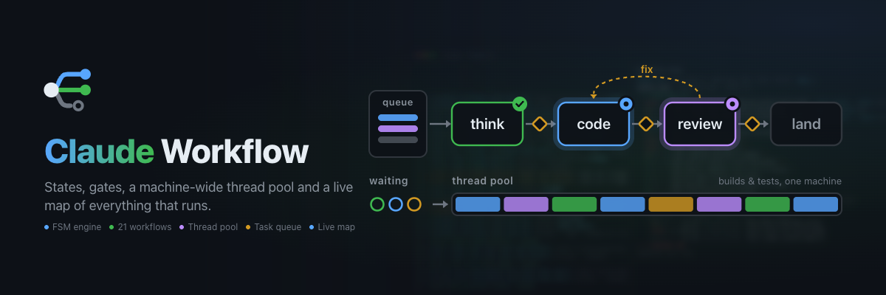
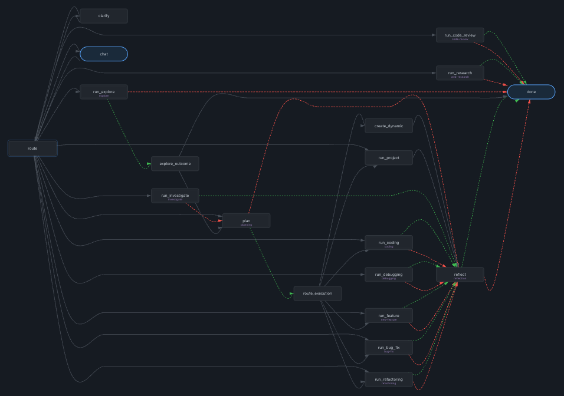

<p align="center">
  
</p>

<p align="center">
  <a href="https://www.npmjs.com/package/claude-mcp-workflow"></a>
  <a href="LICENSE"></a>
  <a href="https://www.typescriptlang.org/"></a>
  <a href="https://code.claude.com/docs/en/plugins"></a>
</p>

A Claude Code plugin that drives agents through YAML-defined state machines. The engine tracks state, enforces guards, manages nested sub-workflow stacks, and visualizes everything in a web dashboard.



## Features

- **FSM-based state machines** — define workflows in YAML with states, transitions, and prompts
- **Stack-based sub-workflows** — states can push nested workflows (max depth 10), auto-pop on completion
- **Three-tier loading** — bundled templates < global (`~/.claude/workflows/`) < project (`.claude/workflows/`)
- **Snapshot isolation** — workflow definitions frozen at session start; hot-reloads don't affect running sessions
- **Runtime overlays** — modify workflows on the fly without touching YAML files
- **Action states** — `exec` runs shell commands, `fetch` makes HTTP requests, with auto-routing by exit code or HTTP status
- **Web dashboard** — real-time session monitoring with DAG graph visualization
- **20 bundled workflows** — complete agent lifecycle from routing to reflection, including long-running batch orchestration and a text-only `docs` route
- **28 bundled skills** — reusable knowledge modules auto-provisioned on first run
- **SessionStart hook** — auto-provisions missing skills and injects workflow context
- **Pool gate** — a PreToolUse(Bash) hook runs the commands a project marks heavy (`.claude/workflows/pool-gate.yaml`) under `wf-run`, so agents' own test runs and builds share the machine-wide thread pool too
- **Agent types** — the plugin ships subagent types in `agents/`: `workflow:driver` (haiku/low; the task-driver rules, workflow tools only), `workflow:recon` (sonnet/medium) and `workflow:reviewer` (opus/high), both read-only: no Edit tool, a Write tool limited by a PreToolUse(Write) hook to the task report directory (absolute path in scratch space with a `<task>.log` / `<task>-logs` directory in it, outside any git work tree, no `..`; a write inside the worktree is refused), and a PreToolUse(Bash) hook (`hooks/read-only-gate.sh`) refuses a Bash call made by those types unless every pipeline segment starts with a declared reader (an ALLOW list: `ls cat head tail wc rg grep jq find git log/show/diff/status/grep/blame…` plus the config `read` list; `envAllowed` names the variables a `NAME=value cmd` prefix may set (any other assignment is refused; `GIT_*`, `PAGER`, `LD_*`, `DYLD_*`, `PATH`, `BASH_ENV`, `ENV`, `IFS` stay refused even when listed); `$( )`, backticks, brace expansion (nested `{{},-i}` included), `printf -v`, a variable in a command word, a variable or glob as a redirect target, a descriptor duplicate that is not the whole word (`>&1foo` writes the file `1foo`), `perl -i`, `python -c`, `node -e`, `tee`, `dd`, `cp`/`mv`, `find -delete` are refused) and any write (redirects into the tree, `git commit/add/rm/mv/stash/reset/checkout…`, `sed -i`, `rm/mv/cp`, plus the project's `.claude/read-only-commands.yaml`: `{ "read": ["apq"], "write": ["apq patch", "/regex/"], "env": { "APQ_READ_ONLY": "1" }, "envAllowed": ["APQ_TEST"], "agents": [...] }`) and, only when a segment starts with a project `read` CLI, exports `env` before the command (other allowed calls pass unchanged). Measured (a real `claude -p` run with a dumping PreToolUse hook, 2026-11-07): the payload of a subagent's Bash call carries `agent_id` and `agent_type`, the main session's carries neither, so it is never touched. Measured again 2026-11-08 with a real `workflow:recon` agent: a write-class Bash call was refused, so the payload carries the qualified name and the gate compares `agent_type` exactly against `agents` — default `workflow:recon`, `workflow:reviewer`; a bare `reviewer` or `other:reviewer` is never matched unless a project lists it. For a read-only agent the read-only hook owns the single rewrite: it exports `env` (only for a project `read` CLI), then applies the pool gate to the prefixed command (`pool-gate-hook` stays out), so a wrapped heavy command still carries the variables; a rewrite it emits carries `permissionDecision: "allow"` (auto mode refuses an unallowed rewritten call) only when every segment is a project `read` CLI, a default that reads no file (`cd echo printf pwd test date basename dirname true false`) or a stdin filter behind a pipe with no file operand (`head tail wc sort uniq cut nl tac tr grep rg`; for grep / rg the value of a value-taking flag is not an operand, so `grep -C 3 x` and `rg -m 5 x` qualify while `grep -C 3 x f` does not; never behind `xargs`, never with `--files0-from`): the allow skips the permission system for the whole call, so a call that needs the rewrite (a project reader's env export, a pool wrap) and carries a file-reading default (`hxq lint a.hx; cat ~/.ssh/id_rsa`, `hxq lint a.hx | xargs head`) is DENIED with `run it in its own call` — the env is neither dropped silently nor exported without an allow. **What this gate is and is not**: it guards a reviewer / recon against ACCIDENTAL writes, not an adversary — shell parsing cannot close every path. The guarantees are exactly three: no Edit tool and a Write limited to the report directory, the project's CLI read-only env, and the allow list of readers above. Out of scope, named: a reader reached by a path (`./ls`, `/tmp/x/cat` — judged by its base name), a flag injected by an inherited variable (`sort $FLAGS`; an allowed call cannot set one), an allowed reader that is itself scriptable, a file the call reads that it should not. A rewrite by a hook outside the plugin (e.g. RTK's own) is not composed — Claude Code keeps one `updatedInput` — so the refusal list is the guarantee and the env is defence in depth. A project extends a type in its own `.claude/agents`. Takes effect after a Claude restart
- **Survives a restart** — when Claude Code exits, its sessions are suspended, not abandoned; `claude --resume` continues them (`resume`), sub-agents included, and an exec that was running keeps running and is taken over

## Install

```bash
/plugin marketplace add https://github.com/anthropics/claude-plugins-community
/plugin install workflow
```

Other install channels (this repository, npm, a local checkout, manual) and the first workflow: [Getting started](https://axgord.github.io/claude-workflow/getting-started).

## Documentation

The full documentation is the site **https://axgord.github.io/claude-workflow/** (sources in `docs/`, built with VitePress: `npm run docs:dev`, `npm run docs:build`).

| Page | Covers |
|------|--------|
| [Getting started](https://axgord.github.io/claude-workflow/getting-started) | Install channels, the CLAUDE.md snippet, permissions, configuration |
| [Concepts](https://axgord.github.io/claude-workflow/concepts) | How it works, bundled workflows, bundled skills, MCP tools |
| [Workflow YAML](https://axgord.github.io/claude-workflow/workflow-yaml) | The file format, three-tier loading, `extends:`, project workflows |
| [Action states](https://axgord.github.io/claude-workflow/action-states) | `exec`, `fetch`, the thread pool, routing, fan-out, template variables, guards, stall detection |
| [Task queue and dispatch](https://axgord.github.io/claude-workflow/queue) | `batch`, `queue_next`, `wf-queue`, the model table, the task driver, the calibration report |
| [Dashboard and plan pane](https://axgord.github.io/claude-workflow/dashboard) | The plan pane, the web dashboard and live map, the status line |
| [FAQ](https://axgord.github.io/claude-workflow/faq) | Troubleshooting |

## Development

```bash
npm run build    # tsc 7 (the `typescript7` alias) → compiles src/ to build/
npm run dev      # tsc 7 --watch
npm start        # node build/index.js
npm test         # vitest run
npm run check    # tsc 7 --noEmit + format:check + lint + scan + vitest + check:ci (the pre-commit gate)
npm run check:ci # the suite as CI runs it (scripts/check-ci.sh): env -i, an empty HOME, no system git
                 # config, TMPDIR inside it, git user.useConfigOnly (no guessed identity), TZ America/St_Johns (CHECK_CI_TZ),
                 # LANG=C — plus CI's package.json / plugin.json version check
npm run lint     # typescript-eslint (type-checked); fails only on findings absent from eslint-baseline.json
npm run lint:baseline  # re-record eslint-baseline.json (after fixing findings, to ratchet down)
npm run format:check   # biome format check (formatter only; part of check)
                       # TypeScript: the compiler is 7 (devDependency `typescript7`, `npm:typescript@^7`, run as
                       # node_modules/typescript7/bin/tsc); `typescript` stays ^5.9 because typescript-eslint (peer <6.1),
                       # the tests that transpile dashboard sources and tsserver (editor LSP) need the JS compiler API 7 lacks
npm run scan     # ast-grep scan --error: structural rules in rules/ (sgconfig.yml), e.g. .then() without .catch(); 0 findings
```

### Architecture

| File | Responsibility |
|------|---------------|
| `src/index.ts` | Entry point — wires components, starts stdio transport |
| `src/workflow-dirs.ts` | The one owner of the workflow directories (`WORKFLOW_DIR`, the cwd's `.claude/workflows/`, bundled `templates/`): `workflowDirs` / `workflowLoader`, built by the server and by `session-cli.js` alike |
| `src/engine.ts` | FSM core — start, transition, abort, context, stack push/pop |
| `src/loader.ts` | YAML loading + Zod validation + fs.watch hot-reload |
| `src/storage.ts` | JSON persistence with atomic writes and lockfile mutex |
| `src/modifier.ts` | Runtime overlays + create (YAML writer) |
| `src/tools.ts` | MCP tool registrations + response formatting |
| `src/executor.ts` | Action state execution — shell commands (`exec`, a `resource:` exec under a pool lease) and HTTP requests (`fetch`) |
| `src/pool.ts` | Machine-wide thread pool: config, admission pass, lease acquire/release under a file lock |
| `src/wf-run.ts` | The `wf-run` CLI over the pool |
| `src/queue.ts` | Task queue files: parse, admission (`after:` / `touches:` / `owner:` / pause), `[.]` marks under the queue's lock |
| `src/queue-cli.ts` | The `wf-queue` CLI over `queue.ts` (exec form of `queue_next` / `queue_mark`) |
| `src/process.ts` | Process-group kill and pid liveness |
| `src/stale.ts` | Stall detection: a state's `stale_after` (type defaults) and whether a session is STALE |
| `src/template.ts` | Mustache-style `{{var}}` template rendering for action parameters |
| `src/dashboard.ts` | Express REST API + static file serving |
| `src/dashboard-routes.ts` | The dashboard's route table (path <-> view), shared by the page and the tests |
| `src/event-fold.ts` | The event log's `fold` and `seedEvents` (a session file's events), pure; served as `/event-fold.js` |
| `src/map-layout.ts` | The live map's `layout` (bands, lanes, branches, loops, stops, questions) and keyed `scene`, pure; served as `/map-layout.js` |
| `dashboard/` | The page: `index.html` (views, `ui` component helpers), `map.js` (the live map: events, keyed SVG transitions, follow mode, view anchoring), `stable.js` (in-place refresh, scroll memory), `tokens.css` (the only colour literals), `components.css` |
| `src/types.ts` | Zod schemas, TypeScript types, constants |

## License

MIT
